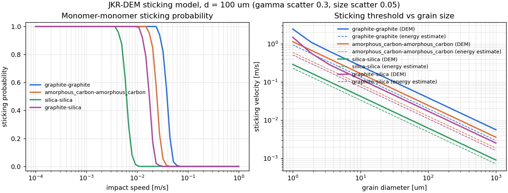
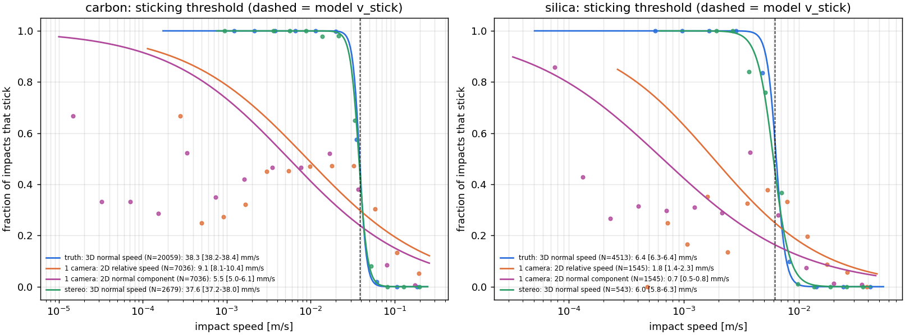
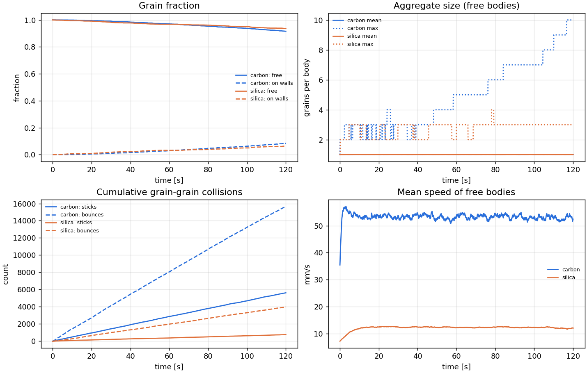
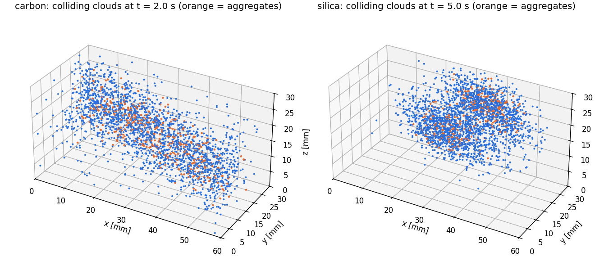
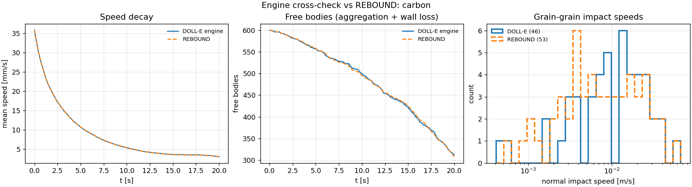

# 100micron-sim — DOLL-E dust-collision simulator

**DOLL-E: Dust Observations in Low-gravity and Low-pressure Environments**

This simulator models ~100 µm dust grains colliding in microgravity inside a
low-pressure experiment chamber on a sounding rocket. It is built to answer one
mission question: *at what impact velocity do astrophysically relevant grains
(carbon vs. silicates) stick, and can our payload measure it?*

It can also simulate the **whole flight in one sweep**: several glass tubules
on one deck, from lift-off through both motor burns, spin, de-spin, the
microgravity window, re-entry and the parachute to splashdown, on one clock (see
[Mission runs](#mission-runs-the-whole-flight-in-one-sweep)).

It was written from scratch for DOLL-E and has two engines:

* **The full-contact engine (v0.6; every mission run).** Every grain is a sphere with six degrees of freedom and
  every grain–grain and grain–wall contact is resolved with the full adhesive contact law at full stiffness:
  JKR normal force with hysteresis, damping and plastic flattening, plus sliding, rolling and twisting springs
  with their limits (Wada et al. 2007; Dominik & Tielens 1995, 1997), written in the form of the LAMMPS GRANULAR
  package and identical to it term by term (differences ≤ 2.2×10⁻⁶ in 7 set-ups). There are no rigid
  aggregates, no fragmentation rules and no frozen wall grains: stuck grains are ordinary contacts that can
  roll, slide, twist and break. A full-stiffness run of the whole flight would take ~10⁴ core-days, so the
  engine uses the full model wherever something can happen and **exact or verified** treatments elsewhere:
  exact free flight up to the earliest time a grain could come within 0.1 µm of anything (and again after each
  contact, up to the next such time, so a bouncing grain is in the full model only near its bounces); resting grains and
  wall-anchored clusters held static while a certificate shows every contact stays inside its elastic limits;
  grains rolling on one wall, and stuck clusters rolling along a wall, on slaved models (the stiff contact modes held quasi-static, rolling and twisting integrated with the full springs) that match the full model to ≤ 3×10⁻⁵ of the rolled path; clusters that are still rocking sleep with that residual motion kept as exact linear response and added back when they wake. **Every step is checked
  after it is taken** and redone in the full model if any assumption one grain's treatment made about another
  failed; as a last safety net, a grain that reaches the full model overlapping something it has no contact with
  (which no bound allows) also makes the step be redone. See [All checks and criteria](#all-checks-and-criteria).
* **The event-driven engine (v0.5; long free-flying cloud runs, `run`, and the browser app).** Grains and rigid
  aggregates fly under the external forces in millisecond steps (velocity Verlet with exact drag and Coriolis;
  Dullweber–Leimkuhler–McLachlan rotation). Impacts are found by continuous collision detection, processed in
  time order, and each is resolved by integrating the same JKR + damping + plasticity law in nanosecond steps;
  stuck grains form rigid aggregates, which fragment by the Dominik & Tielens (1997) energy thresholds. This
  is what makes 15-minute runs of thousands of free-flying grains cheap; its two approximations (rigid
  aggregates, fragmentation rules) are the ones the full-contact engine removes.

## Where everything comes from

* **None of the physics comes from REBOUND or LAMMPS.** No code from either
  is copied, translated or called by the simulator, and it runs with both
  unavailable. `tests/test_provenance.py` checks that only `rebound_check.py`
  imports REBOUND and only `lammps_check.py` imports LAMMPS, that the
  simulator never imports those files, and that a simulation runs with both
  blocked.
* REBOUND is used in one optional file, `dolle_sim/rebound_check.py`. It re-runs
  a simplified chamber in REBOUND as an outside check of our trajectory
  integration and collision bookkeeping. It does not check the sticking
  physics (see [Validation](#validation)). Two of our methods are standard ones
  REBOUND also uses (second-order leapfrog / velocity Verlet, direct-sum
  gravity), and our collision detection is related to its "line" mode, all
  written independently.
* LAMMPS, a widely used open-source particle code, is used in two optional
  files: `dolle_sim/lammps_check.py` compares our 1-D JKR contact with LAMMPS's
  own implementation, and `tools/lammps_contact_check.py` runs the full-contact
  engine's 3-D contact law (normal, sliding, rolling, twisting, walls) side by
  side with LAMMPS (see [All checks and criteria](#all-checks-and-criteria)).
* The physics comes from published contact-mechanics and aerosol papers,
  textbook mechanics and electrostatics, and some derivations and choices of
  our own. **[PROVENANCE.md](PROVENANCE.md)** lists every component with its
  source, its place in the code, how it is checked, and what it assumes, each
  marked *published*, *standard*, *derived* or *assumed*. The same table is on
  the website's Sources tab and in `python -m dolle_sim sources`. It is
  generated from `dolle_sim/provenance.py`, and each module's docstring has a
  one-line provenance note.
* **The weakest link is the material data, and it matters a lot.** With the
  commonly used values, graphite is predicted to stick below ~38 mm/s and
  silica below ~6.2 mm/s. Of that 6.2× ratio, 2.5× comes from the published
  surface energies, 1.7× from the published elastic constants and 1.5× from our
  assumed restitution values (e_dry). The assumed damping also sets most of
  each threshold: without it graphite would stick only below 16 mm/s. Doubling
  a surface energy raises its threshold ~1.8×. Published estimates for dry
  silica in vacuum (Kimura et al. 2015) are up to ten times the commonly used
  surface energy, which would put silica's threshold at 28–42 mm/s, as high as
  graphite's; other work (Kreuzig et al. 2024) finds no such effect for
  hydrophobic amorphous silica. **Measuring this is what DOLL-E is for.** The
  full sensitivity table is at the end of PROVENANCE.md.

### Why our own engine, and not REBOUND or LAMMPS as the base?

We checked both against their source code and documentation (the full notes are in PROVENANCE.md and
`tools/lammps_benchmark.py`). What decides it is the time scales. A sticking contact between two 100 µm grains
lasts about a microsecond and must be followed in ~10 ns steps, but the flight lasts 15 minutes.

* **REBOUND** (v5.2) is an N-body code for planets and rings. It has no walls (its boundaries are open,
  periodic or shear), no grain spin or moment of inertia, and no aggregates (it can only merge stuck grains
  into one sphere). It also has no gas drag, no electrostatics and no adhesive contact. Its collision hook runs
  after a full step without the contact time. Building on it would mean writing all of DOLL-E's physics
  anyway, and it is GPL-3.0. We use it as an outside check of our trajectories and collision bookkeeping.
* **LAMMPS** (GRANULAR package) is the closest established code. It has real JKR adhesion with hysteresis,
  friction, rolling resistance, JKR walls that can vibrate, breakable bonds and rotating-frame forces through
  its standard fixes. But it moves every grain with one global time step. Measured on this laptop,
  `tools/lammps_benchmark.py` runs 2.3×10⁷ grain-steps per second per core with the grains in flight (no
  contacts) and 6.1×10⁶ with the settled layer on the bottom (every grain in a JKR wall contact). At the
  ~10 ns step real glass and silica need, one tubule from lift-off to power-off takes **13–49 core-days**
  (35–130 to splashdown). DOLL-E takes 3 minutes to 10 hours for all four tubules from lift-off to
  splashdown on 4 cores (the 10 hours are the 500 g shaker, whose fast walls force short steps).
* **Softening the grains** is the usual DEM shortcut, but it does not work here. The JKR sticking speed scales
  as E^-1/3, so a 1000× softer grain sticks 10× faster. The standard correction, lowering the surface energy
  by (E_soft/E)^(2/5) (Hærvig et al. 2017; Chen et al. 2019; Washino et al. 2024), keeps the sticking
  speed but cuts the force needed to pull a grain off a wall 16×. That force is what decides launch and
  release.
* LAMMPS also lacks sticking grains that merge into rigid aggregates and contact charging (new C++ code).
  Free-molecular drag can be scripted with its variables but would need validating. A plugin could replace the
  integrator, but every existing granular pair style and fix assumes the one global step.

So DOLL-E does not move every grain with one global step. The full-contact engine (v0.6) runs LAMMPS's own
contact law at full stiffness, but only on the grains that can interact at that moment; everything else is
either flying exactly, resting under a certificate, or rolling on a slaved model, and each step is verified
afterwards. The event-driven engine (v0.5) is cheaper still for free-flying clouds, at the price of rigid
aggregates and fragmentation rules. LAMMPS is the independent referee of the contact law
(`tools/lammps_contact_check.py`, `lammps-check`).

## Use it online

**https://thebestproever.github.io/100micron-sim/** (GitHub Pages, served from `docs/`)

* **Run in browser:** the real simulator running locally in your browser via
  [Pyodide](https://pyodide.org) (Python on WebAssembly). Nothing to install and
  nothing is uploaded. You can edit every parameter in a form, every material
  property in a table, or the full config as JSON. Run the pre-flight check or a
  simulation, then get charts, a 3D replay and CSV downloads. Configs can be
  saved and loaded.
* **Sticking calculator:** threshold and sticking-probability curves for any
  material pair, plus inferring γ from a measured sticking speed.
* **Flight:** the launch-load report for editable tubules (dust, sizes, glass,
  stickiness, orientation, deck position), computed in the browser, and the
  stored results of the full-flight scenario runs.
* **Verify:** runs the 26-check physics verification suite in your browser,
  with PASS/FAIL, measured values and tolerances, and shows the stored results
  of the desktop REBOUND cross-check.
* **Sources:** where every part of the physics comes from (generated from
  `dolle_sim/provenance.py`).
* **Replays:** down-sampled 3D replays (500 grains, first 60 s) of the desktop
  flight simulations.

The browser version is the same code without numba. It uses 100 instead of 300
contact sub-steps (sticking thresholds shift by < 0.3%; restitution by up to
~0.004, and up to ~0.02 just above the threshold, where e is small), so keep
browser runs to a few hundred grains and a few seconds; run the full flight
locally. The site is rebuilt with `python tools/build_site.py --replays --figures`.

---

## Quick start

```bash
pip install -r requirements.txt
python -m dolle_sim preflight configs/flight_carbon_vs_silica.json   # seconds: design checks + force budget
python -m dolle_sim run configs/flight_carbon_vs_silica.json         # full simulation (~1 hour on a laptop)
python -m dolle_sim analyze results/flight_carbon_vs_silica          # re-run the camera analysis on saved results
python -m dolle_sim sweep                                               # sticking probability vs speed curves
python -m dolle_sim invert --material graphite --vstick 0.08            # measured v_stick -> effective surface energy
python -m dolle_sim rebound-check configs/flight_carbon_vs_silica.json --duration 60 --max-grains 600   # cross-check vs REBOUND (~6 min)
python -m dolle_sim lammps-check                                        # contact model vs LAMMPS (~1 min; pip install lammps)
python -m dolle_sim mission configs/mission_quarter_deck.json --loads-only   # launch-load report for every tubule (seconds)
python -m dolle_sim mission configs/mission_quarter_deck.json --jobs 4       # whole flight, all tubules, one clock
python -m dolle_sim sizes --d10 80e-6 --d50 95e-6 --d90 114e-6 --weighting volume   # supplier percentiles -> number distribution
python -m dolle_sim sizes --image micrograph.png --um-per-px 1.25                 # measure grain sizes from a photo
python -m dolle_sim materials                                           # material database
python -m dolle_sim verify                                              # 39 checks: 26 model + 13 full-contact engine
python -m dolle_sim sources                                             # where every component comes from
python -m pytest -q                                                     # all tests (includes both verification suites)
python tools/lammps_contact_check.py                                     # 3-D contact law vs LAMMPS, 7 set-ups (pip install lammps)
python tools/checks_table.py                                             # CHECKS.md: every check, criterion and measured value
python tools/run_campaign.py                                             # every mission scenario, launch to splashdown
```

`run` writes to `results/<name>/`:

| file | contents |
|---|---|
| `viewer.html` | interactive 3D replay (open in any browser, works offline): rotate/zoom, colour by material / aggregate size / **spin rate**, collision flashes, **hide grains stuck to the walls**, live impact-speed histogram |
| `sticking_measurement.png` | stick fraction vs impact speed, true 3D vs **what the camera would measure**, logistic fits with 1σ bootstrap errors (sampling noise only; probably too narrow, see Validation) |
| `collision_velocities.png`, `timeseries.png`, `aggregate_sizes.png` | impact-speed histograms, cloud evolution, aggregate growth |
| `<chamber>/collisions.csv` | every impact: time, grains, materials, normal/tangential/relative speed, effective mass, outcome, restitution, plastic yield flag, charges, spins, contact point, collision and dissipated energy, fragments |
| `<chamber>/camera_measurements.csv` | per impact: in field of view / in focus / trackable, true and camera-measured speeds |
| `<chamber>/timeseries.csv`, `trajectory.npz`, `summary.json` | time series, full trajectories, all statistics + pre-flight report |

---

## Mission runs: the whole flight in one sweep

`python -m dolle_sim mission configs/mission_quarter_deck.json` simulates every tubule on the deck through the
whole flight on **one clock**, from lift-off (T+0, dust resting on the bottom of each tubule) through re-entry
and the parachute to 5 s after splashdown (T+887 s). The example config has four 0.5 × 0.5 × 1.5 in glass tubules on a quarter deck (half of
the ~12 in deck, 5.00 in high), with two dusts, two grain sizes and two glass surfaces. Materials, sizes, dust
amounts (800 grains each) and positions are **examples**: replace them with the real ones.

| phase | T+ (s) | what the dust feels | source |
|---|---|---|---|
| first-stage burn | 0–5.2 | 25 g pressing it onto the bottom; spin starts | RockSat User Guide 2026, Table 3-1 (flat 25 g envelope assumed) |
| coast between burns | 5.2–17.4 | ~3 g drag pulling it toward the top | derived from mission fact sheets (estimate) |
| second-stage burn | 17.4–29.1 | 25 g; spin rises to 4.8 Hz (up to ~9.5 g sideways at 10 cm from the axis) | guide (linear spin-up assumed); the guide's ~±10 g lateral ascent load enters the load report only |
| coast | 29.1–54 | drag falling from ~3 g to ~0.01 g; 4.8 Hz spin | derived estimate |
| de-spin | 54–54.9 | yo-yo de-spin to 1 rpm (Euler force) | fact sheets; Ettl & Pfaender (2009) |
| coast to ~100 km | 54.9–88 | ~0.01 → 10⁻⁴ g | derived |
| microgravity (above ~100 km) | 88–313 | 10⁻⁴ g residual along the rocket axis (toward the top until apogee at T+197 s, toward the bottom after), 1 rpm residual spin | 100 km crossings derived from fact sheets; residual assumed |
| re-entry | 313–460 | the payload turns side-on; drag rises to a **7.9 g** peak at T+369 s (~23 km); experiment power-off at T+332 s | point-mass fall through NRLMSIS 2.1 (integrator verified against Allen & Eggers with gravity off); such models read 5–20% low against measured flights, so ~8–11 g; side-on: DLR flight data |
| parachute opening | 460–463 | from 94 m/s to the descent speed, peak **5 g** | chute time: guide; 4.6 km: NASA fact sheet; 5 g: NASA-MSFC (1975) |
| under the parachute | 463–882 | 1 g toward the **nose** end (hanging nose down), 9.4 m/s at sea level | splash time: guide; nose down: a 2016 student flight log on a related rocket |
| splashdown | 882 | ~**31 g** toward the nose end for ~0.05 s | momentum (9.4 m/s); stopping time and direction assumed (that log saturated sideways) |
| afloat | 882–887 | 1 g sideways (floating on its side) | the same flight log |

`--loads-only` prints the **launch-load report** in seconds. For each tubule it gives the pull-off thresholds
of its dust: the JKR pull-off force 1.5πwR divided by the grain's weight, sampled over the size distribution
and the scatter in stickiness. It then compares them with the loads of every phase. For the example tubules
on clean or silanised glass:

| tubule | pull-off threshold: 10% / 50% / 90% of grains below | largest load pulling dust off the bottom: ascent / whole flight | sideways load: spin alone / with the guide's ±10 g lateral |
|---|---|---|---|
| T1 silica 90–106 µm, bare borosilicate | 498 / 1,087 / 2,386 g | 3 g (coast drag) / 31 g (splashdown) | 9.6 / 19.5 g |
| T2 graphite 90–106 µm, bare borosilicate | 784 / 1,712 / 3,757 g | 3 / 31 g | 7.4 / 17.4 g |
| T3 silica 45–53 µm, silanised | 1,153 / 2,517 / 5,524 g | 3 / 31 g | 7.4 / 17.4 g |
| T4 graphite 45–53 µm, silanised | 1,816 / 3,963 / 8,698 g | 3 / 31 g | 9.6 / 19.5 g |

Re-entry (7.9 g) presses sideways, along the bottom face, because the payload falls side-on. The 31 g
splashdown pulls the dust off the bottom only if the payload hangs nose down, as assumed.

**What this means for the design** (with the stated inputs):

1. **Adhesion, not the boost, holds the dust down.** A 100 µm grain sticks to clean glass about a thousand
   times harder than its own weight, so the 25 g boost is irrelevant: nothing comes off at any phase, the
   ~31 g splashdown included. This
   follows directly from the measured work of adhesion (w = 0.045 J/m² for ~90 µm glass beads on glass,
   Sansao et al. 2021).
2. **A gentle shaker frees nothing.** The nominal 50 g / 200 Hz shaker releases 0 of 3,200 grains (full
   simulation, below). Release needs accelerations above the thresholds (10–90% of grains: ~500–8,700 g for
   the examples), i.e. a sharp kick or ultrasonic excitation.
3. **A kick releases most grains at close to the wall's peak speed.** For a sinusoidal pulse that is
   a/(2πf): 5,000 g at 5 kHz gives ~1.5 m/s (the simulation finds a median of 1.2–1.5 m/s; only grains whose
   threshold is close to the peak leave slower). That is about 250 times the predicted sticking speed of
   100 µm silica. To free 1,000 g-bound grains at ~cm/s, the frequency must be ~100 kHz or more
   (ultrasonic), or the grains must be slowed afterwards (gas).
4. **Bare glass walls recapture the grains within seconds** (wall sticking speed ~8 mm/s for silica on clean
   glass), which limits the observing time after each release. This is why the earlier example configs
   assume an anti-stick coating and vibrating walls.
5. **Rolling (modelled from v0.6).** The sideways spin load (~7–10 g for the example layout, up to ~14 g at the
   deck edge) is above the rolling threshold of most grains (~1.3 g for 100 µm silica on clean glass with the
   nominal rolling hysteresis; uncertain by ~50×, see PROVENANCE.md), so the full-contact engine rolls them across
   the bottom toward the outer wall, where they collide and pile up. Treat the dust layout at release as uncertain
   until the rolling resistance of the real powder is measured.

Scenarios that share the same flight up to some time continue from a checkpoint of one run instead of repeating it (`--checkpoint-at`, `--resume-from`; `tools/run_campaign.py` sets them up). The branch is verified to be exact: the two scenarios must differ only in the release schedule or flight-profile options and have identical loads up to the checkpoint, and a branched run is bit-for-bit the run from lift-off (tested); otherwise it runs from lift-off.

> **Status (v0.6):** the scenario table below is still from the v0.5 engine (rigid aggregates; wall grains held in place until pulled off, so no rolling or sliding along the walls). The full-contact re-runs of every scenario, launch to splashdown, are in progress and replace it. **They use 100 grains per tubule in every scenario** (the dust amount is not decided; the config's 800 is an example). With the full contact model the dust that rolls along the walls in the coasts and under the spin (T+5 s to the de-spin at T+54 s) costs ~10^4 s of computing per second of flight at 800 grains per tubule (measured on the nominal run: ~60 grains in the full model at once), which is weeks for the campaign on a laptop; 100 grains in every scenario also keeps the scenarios comparable with one another. Impact counts scale with the amount (pairs ~ N^2 at the same density of free grains). Every tubule job autosaves its state every 30 min and continues from it after a crash, bit-for-bit (tested).

The full simulations (`--scenario NAME`; combine with `+`, e.g. `kick+lying`; results go to
`results/mission/<scenario>/`) follow every grain of all four tubules from lift-off to splashdown. Each cell
gives **grains released · grain–grain impacts in the microgravity window** (single-grain impacts that stuck /
all single-grain impacts, and their median speed). Because the 50 g shaker frees nothing, the gas,
orientation and spin options are compared on top of the kick release:

| scenario | T1 silica 90–106 µm, bare | T2 graphite 90–106 µm, bare | T3 silica 45–53 µm, silanised | T4 graphite 45–53 µm, silanised |
|---|---|---|---|---|
| `nominal`: 50 g / 200 Hz shaker, 10 s at T+90 s (vacuum, standing) | 0 · 0 | 0 · 0 | 0 · 0 | 0 · 0 |
| `no_release`: no release mechanism | 0 · 0 | 0 · 0 | 0 · 0 | 0 · 0 |
| `no_drag`: nominal, no drag in the coasts | 0 · 0 | 0 · 0 | 0 · 0 | 0 · 0 |
| `rough_grains`: nominal, stickiness × 0.02 (rough grains or a coating) | 730 · 7051 (223/6189, 471 mm/s) | 588 · 3534 (117/2712, 449 mm/s) | 398 · 637 (39/368, 452 mm/s) | 179 · 124 (4/28, 421 mm/s) |
| `rough_grains+hang_nose_up`: hanging and floating nose up | the same in the window; after it 48 releases (12 at the parachute opening, 36 at splashdown) | the same; 72 (2, 70) | the same; 37 (3 in re-entry, 1, 33) | the same; 6 (0, 6) |
| `rough_grains+shock_oblique`: opening and splash shocks at 45° to the axis | the same; 1 (at splashdown) | the same; 13 | the same; 16 (3 in re-entry, 13) | the same; 8 |
| `strong_shaker`: 500 g / 1 kHz shaker, 5 s at T+90 s | 88 · 125 (0/39, 1071 mm/s) | 28 · 36 (0/2, 882 mm/s) | 6 · 0 | 0 · 0 |
| `kick`: three 5,000 g / 5 kHz single-cycle kicks (T+90, 150, 210 s) | 795 · 186 (3/66, 32 mm/s) | 772 · 239 (28/88, 60 mm/s) | 683 · 48 (0/20, 45 mm/s) | 502 · 28 (5/6, 43 mm/s) |
| `kick+lying`: kicks, tubules lying flat | 795 · 124 (6/30, 12 mm/s) | 772 · 102 (10/34, 117 mm/s) | 691 · 51 (1/14, 15 mm/s) | 510 · 25 (0/1, 160 mm/s) |
| `kick+spin_1hz`: kicks, 1 Hz residual spin (the guide's upper value) | 795 · 3740 (7/1737, 155 mm/s) | 770 · 1074 (21/551, 301 mm/s) | 683 · 778 (2/376, 224 mm/s) | 498 · 201 (4/94, 345 mm/s) |
| `kick+gas_100pa`: kicks, 100 Pa of air | 795 · 48 (0/4, 1045 mm/s) | 771 · 13 (2/7, 973 mm/s) | 683 · 4 | 499 · 1 |
| `kick+gas_1atm`: kicks, 1 atm of air | 795 · 57 (0/9, 548 mm/s) | 770 · 9 (1/7, 436 mm/s) | 683 · 1; 42 floating at power-off | 498 · 3; 20 floating at power-off |

Reading the table (800 grains per tubule, example materials; run times 3 min to 10 h per scenario on 4 cores):

* With dust on clean or silanised glass, **only the kicks free it** (500–800 grains per tubule). No release,
  the 50 g shaker and the 500 g shaker free 0–88.
* After kicks in vacuum there are 25–240 grain–grain impacts per tubule in the window, at median speeds of
  12–160 mm/s. That is mostly above the predicted sticking speeds (~6 mm/s for 100 µm silica, ~38 mm/s for
  graphite), so few stick: 0–6 of 14–66 single-grain silica impacts.
* **Lying tubules** give slower silica impacts (median 12–15 mm/s vs 32–45 mm/s standing).
* A **1 Hz residual spin** gives many more impacts (200–3,700), but its centrifugal push makes them fast
  (155–345 mm/s).
* **Gas** stops the kicked grains within a fraction of a second: few impacts (1–57, mostly right after a
  kick). At 1 atm, 20–42 of the smaller grains are still floating at power-off (T+332 s); re-entry drag
  (sideways, rising to ~0.02 g by then) has pushed the rest onto the side walls.
* **Weakly bound dust** (`rough_grains`, stickiness × 0.02, thresholds ~10–170 g) is freed by the 50 g shaker
  (178–729 grains), but the shaking walls keep it fast (median ~420–470 mm/s).
* **Re-entry, the parachute and splashdown** free nothing from clean or silanised glass: the largest load,
  31 g at splashdown, is far below the ~500 g thresholds. Weakly bound dust loses a few more grains: 3 in
  re-entry (one tubule) and 1–11 per tubule at splashdown, hanging nose down. The 50 g shaker has already
  freed the weakest grains on the bottom. Hanging nose up, the opening shock and splashdown pull on the top
  face instead, where grains stuck during the window, and free 6–72 per tubule; an oblique shock frees
  1–13. None of this changes the impacts in the window, but it changes where the dust is at recovery.
* None of the options gives many impacts near the sticking speeds. For a threshold measurement the
  release has to be gentler (higher frequency, or a peak just above the thresholds), or the grains slowed
  after release.

**Random vibration** is in the time-resolved run only in the `launch_vibration` scenario (v0.6): the guide's
test spectra (thrust 0.051 g²/Hz, lateral 0.029 g²/Hz, 20–2000 Hz) synthesised as Gaussian deck accelerations on
all three axes through both burns, an upper bound because no measured flight spectrum is public. The
launch-load report also estimates it for the flight
(lift-off to burnout) and for the ground vibration test (20 s at 10 Grms on the thrust axis, 20–2000 Hz, the
guide's level; Rice's up-crossing rate for a Gaussian, with the thrust not counted as holding the dust down).
For the clean and silanised glass of the examples it is 0.0% (90% of the thresholds are above ~500 g). For weakly bound dust (`rough_grains`) the **ground
test alone** would free ~18–88% of the grains weeks before flight, and launch vibration ~21–90%.

**Measurements that would pin these numbers down:**

* the **work of adhesion** of the real powders on the real tubule glass and coating, in air and after a
  vacuum dry-out, with the drop-test method of Zafar et al. (2014): it needs only a drop tube and a camera;
* the **size distribution** of each powder (`python -m dolle_sim sizes --image ...`, validated on a certified
  bead standard such as NIST SRM 1004b) or the supplier's laser-diffraction D10/D50/D90 (`sizes --d10 ...`);
* a **release test** on the ground: the fraction released and the release speeds of a candidate kicker,
  filmed at high speed.

---

## Physics included

Every row is detailed, with sources and limits, in [PROVENANCE.md](PROVENANCE.md).

### Environment (chamber frame, rotating with the payload)
| effect | model |
|---|---|
| Residual microgravity | constant vector (default 1e-4 g, an assumed preset) or a **flight IMU CSV** (`accel_csv`: t, ax, ay, az in g, the apparent acceleration of a free grain, i.e. minus the accelerometer reading) |
| g-jitter / vibration | Ornstein-Uhlenbeck coloured noise (rms, correlation time; a generic model, not a measured spectrum) |
| Payload spin (default **0.0167 Hz = 1 rpm**) | centrifugal + exact Coriolis, any spin axis, chamber offset from the axis; spins keep their absolute angular momentum fixed in inertial space |
| Gravity gradient (tidal) | (GM/r³)[3(x·ê_up)ê_up − x] about the rocket CG, at flight altitude (~3e-8 g per 10 cm); ê_up (inertially fixed) rotates in the spinning chamber frame |
| Mutual gravity | Newtonian, grain–grain (negligible for 100 µm grains, included for completeness) |
| Gas drag | Stokes + Cunningham slip correction (Davies' empirical constants): exact in the continuum limit, 2.5% below ideal diffuse-reflection Epstein drag in the free-molecular limit; an aggregate's drag is the sum of its grains' (no shielding) |
| Gas torque on spinning grains | continuum 8πμR³ω and free-molecular ≈ (2π/3)ρ v̄ R⁴ω limits, joined by our own interpolation in Kn |
| Brownian motion | Ornstein-Uhlenbeck kicks consistent with the drag (translation + rotation) |
| Thermophoresis | Waldmann free-molecular law (Kn ≫ 1 only); the 1/(1 + 3.9 λ/L) wall temperature-jump reduction is an uncited approximation |
| Photophoresis | free-molecular law for a conduction-limited sphere, F = (π/3) α J₁ p I R³/(k_p T), derived from kinetic theory (Kn ≫ 1 only); J₁ = absorptivity/2 is an assumption |
| Radiation pressure | from the camera illumination; Q_pr ≈ 1 (black) to 0.3 (transparent) is a heuristic |

### Electromagnetic
| effect | model |
|---|---|
| Coulomb | Ewald split: exact short-range pair sum (r < 3 mm) + **long-range space-charge field** from a particle-mesh Poisson solve with φ = 0 on the chamber walls (sine transform, P3M-deconvolved; 1.3% error in the automated check, up to ~5% near the 3 mm split; tolerance 6%). Contact charging leaves the whole cloud with one sign, and nothing screens it at 1 Pa, so the long-range part matters. φ = 0 on the walls matches a grounded conducting inner surface only |
| Polarisation | charge-induced dipole attraction between charged and neutral grains (Clausius-Mossotti; point dipole, underestimates the force very near contact) |
| Image charges | with the space-charge mesh on (the default for charged grains), walls are grounded conductors (factor 1) at all ranges; without it, the wall material's factor (ε−1)/(ε+1) |
| External E-field | uniform, configurable (e.g. biased electrodes) |
| Lorentz force | q v×B, Earth's field by default (rotating in the spinning chamber frame) |
| Contact (tribo-)charging | condenser model driven by work-function difference, **saturating** at grain potential ≈ Δφ. The effective work functions of insulators are assumed; same-material charging is not modelled |

### Contacts and collisions

**Full-contact engine (mission runs, v0.6).** Every contact, grain–grain and grain–wall, is integrated at full
stiffness with velocity Verlet at 1/50 of the fastest contact period (shorter inside fast impacts); contact
making and breaking are located inside the step.

| effect | model |
|---|---|
| Normal | JKR with hysteresis (forms at δ = 0, breaks at the end of the stable branch), Tsuji-type damping with the JKR radius, Thornton–Ning plastic flattening (as below) |
| Sliding | spring k_s = 8G*a0 on the tangential displacement (Wada et al. 2007), slips at μ(F_ne + 2F_c); μ measured for silica on glass (0.4), silica on silica (0.6) and graphite on graphite (0.5); graphite on glass assumed (0.5) |
| Rolling | spring k_r = 4F_c/R, limit ξ_crit = h·a0/12 (Dominik & Tielens 1995; Krijt et al. 2014; h = 0.5 assumed, uncertain ~50×); a 100 µm silica grain on clean glass starts to roll at ~1.3 g sideways |
| Twisting | spring (16/3)G·a0³, limit G·a0³/(3π) at zero load (Wada et al. 2007) |
| Aggregates | none as such: stuck grains are ordinary contacts that roll, slide, twist and break under the same law |
| Walls | the same law with the wall material; the tubule is rigid, so wall motion (releases, vibration) is a uniform acceleration of the tubule frame |

**Event-driven engine (`run`, browser, v0.5).**

| effect | model |
|---|---|
| Adhesion | JKR with snap-on / pull-off hysteresis (Johnson-Kendall-Roberts 1971; Chokshi, Tielens & Hollenbach 1993). JKR holds for graphite (Tabor parameter ~7–14); for 100 µm silica (~1–2) it is an approximation in the JKR–DMT transition that probably overstates the sticking speed |
| Viscoelastic loss | Tsuji-type damping, evaluated with the JKR contact radius (our adaptation), tuned to each material's dry restitution e_dry. The e_dry values are assumed, and the damping sets most of each threshold (graphite 38 mm/s, 16 mm/s without damping) |
| Plastic yield | Thornton & Ning (1998) limiting-pressure loading; unloading on the flattened contact (radius R_p, overlap δ−δ_p), so the pull-off force rises to 1.5πwR_p. Yield starts far above the sticking speeds (0.8 m/s for graphite), so it does not change the thresholds |
| Friction / spin exchange | Coulomb friction cone (μ = 0.3, assumed) at the contact point with the full collision matrix, which couples grain spin to translation; friction impulses that would create energy are replaced by the frictionless impulse |
| Grain-to-grain variability | log-normal scatter of effective surface energy per grain (roughness) and Gaussian scatter of radius |
| Aggregation | stuck grains become rigid aggregates conserving momentum and angular momentum (they spin). Only the normal impact speed decides stick or bounce |
| Fragmentation | Dominik & Tielens (1997) thresholds on the aggregate's own grain–grain bond energy: erosion > 3 N_c E_break, shattering > 10 N_c E_break (derived for sub-µm grains; an extrapolation here). Bonds break only if the energy the bounce actually dissipated pays for them, and fragments separate with what is left, so kinetic + bond energy never increases (tested for every impact geometry). Grains left without a contact become separate bodies |
| Walls | JKR contact with the wall material × `wall_adhesion_factor` (coatings, roughness), optional **vibrating walls** that re-energise the dust. The impact phase is drawn from the flux-weighted distribution, so wall motion can never let a grain through. Grains stuck to a wall move with it, and impacts onto them are flagged and kept out of the grain–grain statistics |

### Measurement
A synthetic camera (frame rate, field of view, depth of field, centroid noise,
required free-flight frames) decides which impacts the payload would actually
record, measures their speeds with the noise of a k-frame track fit, and fits
the sticking threshold with bootstrap error bars. The optics are idealised:
orthographic views, no blur, perfect calibration and grain matching, and
perfect classification of impacts (single grains vs aggregates, stick vs
bounce). Three analysis strategies are compared:

| strategy | what is measured | flight run, graphite / silica (truth 38.3 / 6.36 mm/s) |
|---|---|---|
| 1 camera, 2D relative speed | \|projected centroid v_rel\| | 9.1 / 1.82 mm/s: **4.2× / 3.5× too low** |
| 1 camera, 2D normal component | v_rel projected on the imaged line of centres | 5.5 / 0.66 mm/s |
| **2 orthogonal cameras (stereo)** | 3D normal impact speed | **37.6 [37.2–38.0] / 6.01 [5.80–6.31] mm/s** |
| stereo, 1 µm centroiding | 3D normal impact speed | 38.2 [37.9–38.6] / 6.25 [6.08–6.48] mm/s |

In the model, sticking is set by the *normal* impact speed (an assumption;
real tangential motion may also matter). With one camera, oblique impacts
stick at high relative speed and the line-of-sight velocity is invisible, so
the inferred threshold is smeared and biased by an amount that depends on the
launch geometry. **Design recommendation: two orthogonal cameras (or one camera
with a mirror giving a second view), analysed on free monomer–monomer impacts
using the line of centres at contact.** The remaining low bias of stereo comes
from velocity noise (5 µm centroids, 500 fps, 6 frames: ~0.85 mm/s per axis),
which the fit does not correct; it is largest where the threshold is lowest
(silica) and shrinks with 1 µm centroids. A faster camera with the same number
of tracked frames makes it *worse*: velocity noise grows as fps / k^1.5, so
what matters is centroid precision and the tracking baseline.
`python -m dolle_sim analyze <results>` re-runs this analysis (optionally with
`--camera '{"fps": 1000}'` overrides) without re-simulating.

---

## Keeping grains off the walls

The goal is grain–grain impacts, not wall sticking. In the model, walls stick
whenever a grain hits slower than the wall sticking velocity. Bare glass
(wall sticking speed ~0.8 cm/s for silica, ~2 cm/s for graphite) captures most
grains within a couple of chamber crossings. The example configs keep grains
bouncing *physically*:

1. **Low-adhesion walls**: a fluorinated (FDTS-type) coating on hard glass plus
   bead-blasting (`wall_material: glass_fluorosilane`,
   `wall_adhesion_factor: 0.05`). With these **assumed** values (the coating's
   γ and the 20× reduction from roughening must be measured on the flight
   hardware) wall sticking drops to ~0.4–1.2 mm/s. Soft PTFE is *worse*: it has
   low γ but a huge contact area, and it is a strong tribo-charger.
2. **Vibrating walls**: 200 Hz with 5–25 µm amplitude, so the wall speed is
   comparable to the target impact speed. This replaces the energy lost in
   inelastic bounces and keeps the grains at the speeds you want to probe.
3. `preflight` reports the predicted fraction of wall hits that stick. If you
   set `wall_sticking: "never"` (idealised walls), it warns that the hardware
   must actually achieve it.

The viewer's **"Hide grains stuck to walls"** checkbox removes the wall-bound
grains from the display.

---

## Results from the example configs

All numbers are for 100 µm grains with the default material database: the
commonly used literature surface energies and elastic constants, and our
assumed restitution values. They predict what the flight would see *if* those
inputs are right (see "Where everything comes from" above).

**Sticking thresholds (model).** Monomer–monomer, 50% sticking speed with
grain-to-grain scatter (`python -m dolle_sim sweep`): graphite **38.7 mm/s**,
amorphous carbon **24.4 mm/s**, graphite–silica **17.3 mm/s**, silica
**6.2 mm/s**. With these inputs carbon grains stick at ~6× higher speeds
than silica: 2.5× from the published surface energies, 1.7× from the published
elastic constants and 1.5× from our assumed restitution values (see above for
how strongly this depends on the inputs).



**Full flight run** (`configs/flight_carbon_vs_silica.json`: 2 × 2000
grains, 120 s, 1 Pa, 1e-4 g, 1 rpm roll, all forces on, anti-stick +
vibrating walls; about 1 hour on a laptop: ~50 min for the graphite chamber, ~9 min for silica):

| | graphite chamber | silica chamber |
|---|---|---|
| grain–grain impacts | 21 281 (5 622 stuck) | 4 728 (758 stuck) |
| wall impacts / stuck | 512 920 / 96 (0.02%) | 132 957 / 114 (0.09%) |
| grains not stuck to a wall after 120 s | 92% | 94% |
| fragmentation events (erosion / shattering), 93% of them dimers broken on fast wall hits | 921 / 4467 | 203 / 513 |
| net cloud charge (contact charging) | +4.9e+07 e (≈ 2.4e+04 e per grain) | +2.1e+07 e (≈ 1.0e+04 e per grain) |
| true threshold (3D normal speed, free monomers) | 38.3 [38.2–38.4] mm/s | 6.36 [6.30–6.42] mm/s |
| **stereo-camera measurement** | **37.6 [37.2–38.0] mm/s** | **6.01 [5.80–6.31] mm/s** |
| single camera, 2D relative speed | 9.1 mm/s | 1.82 mm/s |
| impacts onto wall-bound grains (separate class) | 150 (36 stuck), threshold 30.4 [29.5–31.6] mm/s | 94 (8 stuck), threshold 4.3 [4.0–4.5] mm/s |

The brackets are 1σ bootstrap intervals from sampling noise only; they are
probably too narrow (see Validation), and they do not include the bias from
velocity noise, which is why the silica stereo interval misses the truth.

Impacts onto wall-bound grains see twice the effective mass, so the simple
expectation is the grain–grain threshold /√2 (27.1 / 4.50 mm/s). The grains
that stuck to the walls are on average ~7% stickier than the rest (selection,
measured from the per-grain adhesion factors), which raises that to ~28.8 /
4.75 mm/s. The graphite value is still ~1.4σ above this, and the silica value
rests on only 8 sticks. Fragmentation is dominated by dimers breaking on fast
wall hits, which relies on the extrapolated Dominik & Tielens thresholds.





**Colliding clouds** (`configs/colliding_clouds_carbon_vs_silica.json`, 60 s):
the true thresholds are 38.2 [38.1–38.4] / 6.26 [6.19–6.33] mm/s and stereo
measures 37.6 [37.0–38.2] / 6.33 [6.17–6.56] mm/s. A single camera gives
24.6 / 5.62 mm/s here, against 9.1 / 1.82 mm/s in the
isotropic run. Its bias depends on the geometry and cannot be calibrated away.



**Design findings the simulator surfaced** (within the model's assumptions):

1. **Use two orthogonal camera views and ~1 µm centroiding.** With one camera
   the inferred sticking speed is too low by 1.1–4.2×, depending on the
   impact geometry. Stereo with 5 µm centroids reads -5% to +1% off
   (worst for silica in the isotropic run); 1 µm centroids reduce that.
2. **If the assumed anti-stick performance is achieved, anti-stick vibrating
   walls work.** Fluorinated, roughened glass vibrated at 200 Hz (5–25 µm)
   then catches only 0.02–0.09% of wall hits, 92–94% of the grains are
   still off the walls after 120 s,
   and grain–grain impacts accumulate steadily (~177 per second for
   graphite).
3. **Thermophoresis**: at 1 Pa, each kelvin across a 3 cm chamber drives
   ~3.6e-4 g, 3.6× the residual microgravity. Keep the chamber isothermal to
   ≲ 0.1 K.
4. **Residual 1e-4 g sweeps a resting grain across 3 cm in ~8 s**, and the
   1 rpm roll adds Coriolis accelerations of ~7.5e-4 g at 3.5 cm/s. Both are in
   the simulation, so their effect on the measured impact speeds is included.
5. **Contact charging leaves the cloud one sign** (~2e+04 e per graphite
   grain). The long-range space-charge field is therefore included; charge-induced
   polarisation dominates at contact. Lorentz force and mutual gravity are
   negligible (< 1e-12 g).

---

## All checks and criteria

**[CHECKS.md](CHECKS.md)** lists every check and comparison with what it compares, its pass criterion and the
measured value. It is generated by `tools/checks_table.py` from the result files the checks write, so it
cannot drift from the runs:

| group | how to run | what it covers |
|---|---|---|
| Part 1: 26 model checks | `python -m dolle_sim verify` (also in the browser) | analytic solutions, conservation laws, limits and published data for every model component (table below) |
| Part 2: 13 full-contact engine checks | `python -m dolle_sim verify` | the 3-D contact dynamics against the 1-D model; momentum, angular momentum and energy; rolling on a wall against the rigid-plastic solution; cluster statics; the vibration synthesis against its spectrum; time-step convergence; slaved rolling (with spin) and slaved clusters (a stuck pair, a grain on another, a single grain) against the full model; sleeping grains against the full model; free-flight hand-off; sleeping with the residual motion against the full model; **the whole regime machinery, and slaved clusters among other moving grains, against runs with every grain in the full model** |
| LAMMPS, 7 set-ups | `python tools/lammps_contact_check.py` | the same contact law term by term: oblique spinning impacts at 3, 30, 300 mm/s, rolling under a ramp, rocking, twisting, 20 grains dropped on a floor (≤ 1e-5; measured ≤ 2.2e-6) |
| LAMMPS, 6 comparisons | `python -m dolle_sim lammps-check` | sticking thresholds, restitution, pull-off (table below) |
| REBOUND, 6 comparisons | `python -m dolle_sim rebound-check ...` | trajectories and collision statistics of a flying cloud (below) |
| unit and regression tests | `python -m pytest -q` | every module, the flight timeline, mission runs on both engines, provenance |

In every mission run the engine also counts, in `mission_summary.json`, the steps it verified, every redo by the
check that asked for it (`redos_speed_bound`, `redos_outside_record`, `redos_rolling_envelope`, `redos_missed_contact`: the safety net) and
the grains that joined the contact dynamics on approach.

## Validation

`python -m dolle_sim verify` runs the 26-check model suite (the same suite runs in the browser app) and the 13
full-contact engine checks. The model checks:

| test | checks |
|---|---|
| contact: elastic limit, damping, plasticity | energy conservation (e = 1.000), e_dry calibration, Thornton–Ning restitution (no damping; and with damping against e_TN × e_dry, our approximate reference), γ = 0 limit |
| sticking thresholds | DEM threshold = JKR hysteresis estimate without damping; carbon > silica |
| free flight | drag + residual g exact to < 10 nm over 1 s; spinning frame (drag + Coriolis + centrifugal) vs a 10⁻¹² ODE solution of the same equations: < 1 nm at 1 rpm, 2nd-order convergence at 30× the spin rate |
| rigid-body rotation | spinning trimer: angular momentum to 10⁻¹¹, energy error bounded (≤ 1e-4, sampled every step) with no drift; in the rotating payload a spinning grain and an L-shaped aggregate off the spin axis keep their absolute angular momentum fixed in inertial space (10⁻¹³, 2×10⁻¹⁰) |
| collisions | exact normal restitution through the 3×3 impulse matrix for random oblique aggregate impacts, friction cone respected; 2000 eccentric impacts with friction never gain energy; no interpenetration in a dense gas |
| impact energy | every impact measured just before and after it is resolved (grains on spinning chains and L-shaped aggregates from random directions, spinning aggregates on a wall, a closed box of 300 spinning graphite grains; ~1200 impacts, ~95 fragmentations): kinetic + bond energy never increases, no aggregate keeps grains that no longer touch |
| walls | grains forming spinning aggregates against 25 µm / 200 Hz vibrating walls: no grain ever crosses a wall, and the position safety net never has to act |
| conservation | momentum and angular momentum through merging and splitting |
| gas | drag reduces to Stokes in dense gas and is within 2.5% of Epstein in the free-molecular limit; thermophoretic drift matches the textbook free-molecular result to 2.8%; Brownian kicks give equipartition to 1% |
| electrostatics | space-charge solver vs Coulomb's law (1.3% at 1–5 mm along one axis in the check; tolerance 6%); grounded-wall image; charge saturation |
| estimator | the logistic fit recovers known thresholds from synthetic data to < 5%, but its 1σ bootstrap intervals covered the truth in only 9 of 20 trials (nominal 68%), so quoted error bars are probably too narrow |
| bookkeeping | impacts onto wall-bound grains are flagged |
| flight timeline | a grain released during the yo-yo de-spin (Coriolis, centrifugal and Euler forces) vs a 10⁻¹² ODE solution, 2nd-order convergence; a spinning grain keeps its absolute angular momentum (~10⁻¹¹) while the payload spins up to 4.8 Hz; guide timings, roll angle and loads (`tests/test_flight.py`) |
| re-entry | the descent integrator reproduces the closed-form ballistic entry of Allen & Eggers (1958) at 90° and 45°: with gravity off: peak deceleration to ~10⁻⁶, its altitude to < 1 m, v(h) to < 10⁻⁶ (pass limits 10⁻⁵, 5 m, 10⁻⁵); gravity and the NRLMSIS path are covered by tests: parachute and splash impulses equal the momentum changes; the fall reaches 4.6 km at T+460 s and the sea at T+882 s (`tests/test_flight.py`) |
| launch and release | 200 moving grains settle on the aft face under 25 g, none escapes; wall-bound grains come off exactly when the load passes their JKR pull-off force (steady pull and shaker), with the predicted release speeds |
| grain sizes | percentile fits and Hatch–Choate conversion exact; sampling reproduces volume percentiles to 0.5%; image sizing of synthetic micrographs recovers the count (±2) and median diameter (1%) (`tests/test_sizes.py`) |
| provenance | REBOUND is imported only by `rebound_check.py` and LAMMPS only by `lammps_check.py`; the simulator runs with both blocked; every check and code location named in PROVENANCE.md exists; PROVENANCE.md and the website copy are up to date |

Some components have no automated check against an independent reference:
charge-induced polarisation and short-range image charges, photophoresis,
radiation pressure, gas torque, tidal, Lorentz and external-field forces,
g-jitter, the pair-force limiter, the fragmentation thresholds, the mixing
rules for dissimilar materials, the surface-energy inversion and the camera
model. PROVENANCE.md marks these.

`python -m dolle_sim rebound-check` runs a simplified version of the same
chamber in [REBOUND](https://rebound.readthedocs.io), a widely used N-body code
with its own integrators, gravity and "line" collision detection. Both engines
run point-mass grains with residual gravity, payload spin, drag, mutual
gravity, stick/bounce and static walls; electrostatics, g-jitter, gravity
gradient, thermo-/photophoresis, radiation pressure, Brownian motion and wall
vibration are switched off in both.

* **Part 1 (independent integrator):** over the first 0.2 s, for every grain
  with no collision, REBOUND's high-accuracy IAS15 integrator and ours agree to
  < 1 nm. REBOUND integrates the same equations of motion (we type the
  residual-gravity, centrifugal, Coriolis and drag terms into REBOUND), so this
  checks our integration, not the equations or the drag law.
* **Part 2 (partly independent):** collisions found by REBOUND's detection,
  resolved by *our* JKR contact model plugged in as REBOUND's collision
  resolver (rewound to the true contact time), with our exact drag + Coriolis
  velocity step and our wall handling. Over 60 s with 600 grains, grain–grain impacts, sticks, wall hits and stick
  fractions agree within 1σ of counting noise, and the median single-grain
  impact speed is 7.9 vs 7.5 mm/s for carbon (~55 impacts each) and 2.51 vs
  2.53 mm/s for silica. This checks
  detection and bookkeeping, **not** the contact physics, the material values,
  spin, friction, charging or fragmentation.

See the figure and `results/rebound_check/*.json`.



`python -m dolle_sim lammps-check` compares the contact model with
[LAMMPS](https://www.lammps.org) (Thompson et al. 2022), whose GRANULAR package
has its own, independent JKR implementation with the same force law. LAMMPS
breaks a JKR contact at the maximum tensile force; DOLL-E (like Chokshi et al.
1993) follows the curve to the end of its stable branch. DOLL-E can use either
(`JKRContact(separation="force")`), so the comparison uses LAMMPS's criterion:

| test (undamped, 100 µm grains) | LAMMPS | DOLL-E | difference |
|---|---|---|---|
| silica–silica sticking threshold | 2.684 mm/s | 2.691 mm/s | 0.26% |
| graphite–graphite sticking threshold | 10.94 mm/s | 10.95 mm/s | 0.11% |
| restitution at 2× and 4× the threshold | 0.8654, 0.9696 (silica) | 0.8658, 0.9677 | ≤ 0.002 |
| restitution at 1.2× the threshold | 0.555 (silica), 0.560 (graphite) | 0.550 | ≤ 0.011 |
| pull-off from a borosilicate wall (silica, graphite) | 1.0630e-5, 1.8412e-5 N | 1.5πwR = 1.0616e-5, 1.8387e-5 N | 0.14% (loading-rate lag) |

With DOLL-E's default break criterion the undamped thresholds are 1.42× higher
(3.83 and 15.6 mm/s). Damped collisions are not compared: LAMMPS refuses its
Tsuji damping (the law DOLL-E uses) with JKR, and the damping laws it does allow
with JKR differ from DOLL-E's.

### Code reviews (v0.2 to v0.5)

The code was put through automated adversarial reviews by AI reviewers, one
per subsystem, with every finding re-checked by a second AI reviewer before it
was fixed. v0.3 adds a provenance audit of every component and of the public
text (68 confirmed findings), which is the basis of PROVENANCE.md.

The v0.5 additions (re-entry to splashdown, the atmosphere table, the
wall-bound shortcuts, the REBOUND/LAMMPS comparison) were reviewed the same
way: 23 findings from independent reviewers (about a dozen distinct issues),
all fixed. The main ones:

* **The fall attitude started at apogee.** The side-on fall attitude began at
  T+197 s, inside the microgravity window, so the 10⁻⁴ g residual turned
  sideways instead of reversing along the axis. Nothing turns the payload in
  vacuum: the attitude now changes at T+313 s, and every scenario was re-run.
* **The re-entry peak was presented as validated.** The Allen & Eggers check
  tests the integrator with gravity off; it does not validate the 7.9 g peak.
  Point-mass models of this kind read 5–20% low against measured flights, so
  the README now says ~8–11 g and quotes the measured check values instead of
  "< 10⁻⁶".
* **Shock directions.** The cited flight log shows the splash spike mostly
  sideways. The direction is now an option (`shock_oblique` scenario) and the
  default is marked assumed.
* Smaller: the tumbling option rotated only the load direction (now stated,
  and it starts at T+313 s); `np.trapezoid` needs NumPy 2; the summary JSON
  contained `Infinity`; end-of-run counts were labelled "at power-off"; the
  descent forced a neighbour-list rebuild on almost every step.

The v0.4 additions (flight timeline, launch report, release, glass, sizes,
LAMMPS check, web Flight tab) were reviewed in 7 areas. Each finding was
checked by two skeptics told to refute it: 41 findings, 3 refuted, the rest
fixed. The main ones:

* **The residual acceleration never reversed.** After apogee drag acts the
  other way, but the model kept a 10⁻⁴ g pull toward the nose for the whole
  descent, and it counted impacts down to T+332 s although the payload is
  below 100 km from ~T+313 s. Drag now follows the velocity, and the
  microgravity window ends at T+313 s (a separate descent phase follows).
* **The vibration "upper bound" was not one.** It used the 25 g thrust as
  holding the dust down and ignored the coast and the ground vibration test.
  It is now an estimate with the thrust ignored, covering lift-off to burnout
  plus the ground random and sine tests.
* Engine: fragments shaken off a wall-bound aggregate left along the bond
  instead of with the wall; settled beds of two dusts could overlap; a
  negative spin rate rotated the frame the wrong way; `wall_sticking: never`
  walls held grains that came to rest under a load; release windows were
  skipped in runs without a flight profile, and the "do not step over a
  window" branch could never run.
* Reports and docs: "released" counted events, not grains; the camera's
  field of view was transposed and did not follow the tubule orientation;
  sliding ignored the pull at the same instant; the LAMMPS pull-off "0.5%"
  was the detection grid (now 0.14%, checked 100× finer), and LAMMPS does
  allow some damping laws with JKR, just not DOLL-E's (Tsuji).
* Image sizing cut isolated elongated grains (flakes) into pieces. It now
  seeds the watershed with extended maxima and is tested on rods, ellipses,
  irregular flakes and unequal touching pairs.

Problems found and fixed in v0.3:

* **Fragmentation could create energy.** The separation energy was computed
  from the full translational collision energy, so oblique or eccentric
  impacts gave fragments more energy than the bounce dissipated (up to ~1/3 of
  the impact energy). It now uses the energy the impulse actually removed,
  E_diss = P·v_rel − ½PᵀKP, solves the separation kick exactly, and breaks
  bonds only when E_diss can pay for them. Eroding a "bridge" grain could
  leave two grains bonded without touching.
* **The centrifugal torque on aggregates was counted twice** (once explicitly
  and once inside the rotating-frame treatment of spin). Spins also used to
  ignore the rotation of the payload frame.
* Collision prediction for fast-spinning aggregates assumed straight-line
  motion over the whole step. The neighbour-list skin ignored speed gained from
  vibrating walls, and a bounce could make a grain faster than the list
  allowed (now adaptive, with an immediate rebuild). Friction impulses on
  eccentric aggregate impacts could create energy (now replaced by the
  frictionless impulse).
* Pair forces were held for 5 steps (20 ms) in the example configs; they are
  now recomputed every step.
* Smaller fixes: image-charge factor inconsistent between the short- and
  long-range parts, g-jitter starting at zero, double flux weighting in the
  pre-flight wall-capture estimate, polarisation budget ×2, a crash on
  `yield_pressure: null`, a mislabelled "Chokshi" estimate (it is a simple
  energy estimate), the ice density, and graphite's Poisson ratio (now Chokshi
  et al.'s 0.32).
* Many documentation claims were corrected: what is published versus assumed,
  what REBOUND does and does not check, how much the assumed damping drives the
  thresholds, the published spread of silica and graphite surface energies,
  and which components have no automated check.

Problems found and fixed in v0.2:

* Impacts onto wall-bound grains (twice the effective mass, so they stick at
  √2 lower speed) were mixed into the grain–grain statistics. This biased the
  "true" thresholds ~7–15% low. They are now flagged and kept separate.
* Vibrating walls could let grains through (wrong exclusion of grazing contacts).
* Aggregates were fragmented using the grain–*wall* bond energy, so they
  shattered on almost every wall hit. Fragments got no separation velocity and
  re-stuck immediately, producing spurious zero-speed "sticks".
* Post-yield damping acted on a contact that no longer existed, which made
  fast plastic impacts far too inelastic.
* The batched event loop could miss follow-on collisions; the neighbour-list
  rebuild test was too lax.
* Free rotation of aggregates pumped energy (stale angular velocity). Coriolis
  was only first order. The aggregate impulse ignored off-diagonal collision-matrix terms.
* No long-range space-charge field; photophoresis prefactor a factor 2 low;
  inertially fixed vectors not rotated in the spinning frame; aggregate spin-down 1.5× too fast.
* The camera used contact-point velocities (including invisible grain spin).
  The REBOUND check used end-of-step collision normals and a velocity-dependent
  leapfrog.

---

## Configuration

See `configs/flight_carbon_vs_silica.json` (two chambers: graphite vs
silica, isotropic launch) and `configs/colliding_clouds_carbon_vs_silica.json`
(two opposed dust clouds per chamber). Key blocks:

* `environment`: `preset` (`sounding_rocket`, `spinning_rocket`, `ideal`, `drop_tower`), `pressure_pa`, `gas`,
  `residual_accel_g`, `jitter_rms_g`, `spin_rate_hz`, `spin_axis`, `accel_csv`, `gravity_gradient`,
  `altitude_m`, `electric_field_v_m`, `magnetic_field_t`, `temperature_gradient_k_m`, `illumination`
* `forces`: switch any force on/off (`coulomb`, `space_charge`, `polarization`, `image_charges`, `self_gravity`,
  `lorentz`, `external_e_field`, `thermophoresis`, `photophoresis`, `radiation_pressure`, `brownian`);
  `long_range_cutoff_m` (Ewald split radius), `long_range_update_every` (pair forces, default and example
  configs: every step), `space_charge_update_every` (mesh solve, default every 25 steps),
  `photophoresis_accommodation`
* `contact`: `friction_coefficient`, `wall_sticking` (`jkr`/`never`/`always`), `contact_charging`, `fragmentation`
* `camera`: `view_axis`, `fps`, `fov_m`, `depth_of_field_m`, `position_noise_m`, `track_frames`
* `materials`: override any property of any material, or define new ones
* `chambers[]`: `size_m`, `wall_material`, `wall_adhesion_factor`, `wall_vibration`, offsets from the spin
  axis/CG, `release` (shaker or kick windows), and `particles[]` groups (`material`, `count`, `radius_m`,
  `radius_rel_sigma` or `size_distribution`, `surface_energy_log_sigma`, `charge_e_mean/sigma`, `spin`,
  `region_m`, `velocity` isotropic or jet, `initial_state: {"type": "settled", "face": "-z"}`)
* `size_distribution`: `{"type": "sieve", "min_m", "max_m", "fraction_in_range"}`, `{"type": "percentiles",
  "d10_m", "d50_m", "d90_m", "weighting": "volume"}` (laser diffraction) or `"number"` (microscopy),
  `{"type": "lognormal", "median_m", "gsd", "weighting"}`, or `{"type": "measured", "diameters_m" | "csv"}`
  (see `dolle_sim/sizes.py`)

A **mission** config (`configs/mission_quarter_deck.json`) instead lists `tubules[]` (`inner_size_in`,
`orientation` standing/lying, `deck_position_m`, `wall_material`, `dust`, `release`), a `flight_profile`
(timeline; see `dolle_sim/flight.py`), `gas`, `simulate_from_s`, and named `scenarios` of overrides.

## Materials

`silica`, `forsterite`, `alumina`, `graphite`, `amorphous_carbon`, `carbon_silica_50_50`, `water_ice`, and
the wall materials `glass_borosilicate`, `glass_soda_lime`, `fused_silica_glass`, `glass_silanized`,
`glass_bk7`, `glass_fluorosilane`, `sapphire`, `aluminum_6061`, `ptfe`. The four tubule glasses take their
elastic constants from the SCHOTT DURAN / BOROFLOAT 33 and Corning HPFS 7980 datasheets, and their
stickiness from works of adhesion measured for ~90 µm glass beads on glass in air: w = 0.045 J/m² for clean
glass and 0.022–0.030 J/m² for silanised glass (Sansao et al. 2021; Zafar et al. 2014). The silanised value
was measured for silanised beads on silanised glass; untreated grains on a silanised wall, and graphite on
any glass, have not been measured (the combining rule gives the model's values). Each has density,
modulus, Poisson ratio, surface energy, restitution, work function, permittivity, yield pressure, thermal
conductivity and absorptivity, with notes saying which values come from papers
(`python -m dolle_sim materials`). Only the silica γ, E and ν, the graphite γ, E, ν and ρ, and the
water-ice γ, E and ν are taken from the cited papers; everything else, including every e_dry, is a
representative value we chose.

---

## How realistic is it?

It includes every effect we could identify that matters for 100 µm grains at
mm/s–cm/s speeds in a 0.1–10 Pa chamber, plus several that turn out
negligible (mutual gravity, Lorentz force, Brownian motion). The pre-flight
force budget shows which effects matter for *your* configuration.

What no simulation can supply is the **material parameters of your actual
powder**: surface energy, yield pressure and dry restitution. Real grains are
rough, irregular and possibly contaminated, so literature γ values can be off
by a factor of several, and for silica in vacuum the literature itself spans
~10×. That is exactly why the experiment is worth flying. A concrete example:
for ~1.2 µm silica spheres this model (like all JKR theory) predicts
v_stick ≈ 0.25 m/s, but Poppe, Blum & Henning (2000) measured ≈ 1.2 m/s.
Theory with literature parameters can be off by several times, so the
predicted numbers above are design guidance, not the answer.

The intended workflow:

1. Design with the literature values (this repo).
2. Calibrate γ and e_dry with ground tests (drop tower, or low-speed tabletop
   impacts on a substrate). `invert` turns a measured sticking velocity into
   γ_eff.
3. After flight, fit the measured sticking curve. Compare carbon vs silicate γ_eff
   and their trend with work function / electron affinity.

Remaining approximations: grains are smooth spheres, and JKR is an approximation
for silica at this size (Tabor parameter ~1–2). The rolling hysteresis h and the
rolling and twisting damping (Q = 100) are assumed (PROVENANCE.md). The
full-contact engine (mission runs) has no further contact approximations: every
contact rolls, slides, twists and breaks under the full law, and its rest,
rolling and free-flight treatments are verified every step. The event-driven
engine (`run` and the browser) keeps two: aggregates are rigid between impacts
(no rolling restructuring; during an impact the contact sees the whole
aggregate's effective mass, and only the normal impact speed decides stick or
bounce), and fragmentation uses thresholds extrapolated from sub-µm grains. Thermo- and photophoresis use free-molecular formulas (valid at
Kn ≫ 1; pre-flight warns below Kn = 10), and photophoresis ignores shadowing
(the cloud is optically thin). Gas flow is not simulated (free-molecular
regime, Kn ≈ 100). For the long-range field the chamber walls are grounded
conductors. The flight environment presets are representative, not vehicle
data; the mission timeline uses the launch provider's envelope values, not a
measured flight history. The tubule is rigid (its structural modes are not
modelled), and burn vibration is applied only in the `launch_vibration`
scenario, at the ground-test level, as an upper bound (no measured flight
spectrum is public). Every such assumption is listed in [PROVENANCE.md](PROVENANCE.md).

## Key references

The full list, with what each is used for, is in [PROVENANCE.md](PROVENANCE.md).
Johnson, Kendall & Roberts (1971) Proc. R. Soc. A 324, 301 · Chokshi, Tielens & Hollenbach (1993) ApJ 407, 806 ·
Dominik & Tielens (1997) ApJ 480, 647 · Thornton & Ning (1998) Powder Technol. 99, 154 ·
Tsuji, Tanaka & Ishida (1992) Powder Technol. 71, 239 · Dullweber, Leimkuhler & McLachlan (1997) J. Chem. Phys. 107, 5840 ·
Davies (1945) Proc. Phys. Soc. 57, 259 · Waldmann (1959) Z. Naturforsch. 14a, 589 · Rohatschek (1995) J. Aerosol Sci. 26, 717 ·
Matsusaka et al. (2010) Chem. Eng. Sci. 65, 5781 · Kimura et al. (2015) ApJ 812, 67 · Kreuzig et al. (2024) A&A 688 ·
Wang et al. (2015) Nat. Commun. 6, 7853 · Poppe, Blum & Henning (2000) ApJ 533, 454 · Rein & Liu (2012) A&A 537, A128 (REBOUND) ·
Thompson et al. (2022) Comput. Phys. Commun. 271, 108171 (LAMMPS) · RockSat User Guide 2026 (NASA Wallops Flight Facility) ·
Sansao et al. (2021) Powder Technol. 384, 267 · Zafar et al. (2014) Powder Technol. 264, 236 · Rice (1944) Bell Syst. Tech. J. 23, 282 ·
Hatch & Choate (1929) J. Franklin Inst. 207, 369 · van der Walt et al. (2014) PeerJ 2, e453 (scikit-image).
