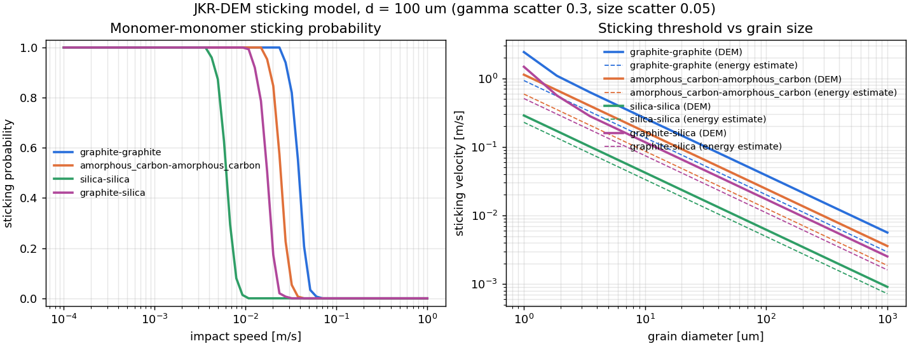

# 100micron-sim — DOLL-E dust-collision simulator

**DOLL-E: Dust Observations in Low-gravity and Low-pressure Environments.** DOLL-E is a sounding-rocket experiment
that films ~100 µm dust grains colliding in microgravity, in small low-pressure glass tubules. Its question: *below
what impact speed do carbon and silicate grains stick, and can the flight measure it?* This repository simulates the
experiment, from the physics of one impact to the whole flight, and explains every part of it.

## Start here

The notebooks explain the physics step by step: each derivation starts from a cited paper, and each "why this
choice" box gives the alternatives and the evidence. Every notebook opens in the browser from its badge.

| notebook | what it answers |
|---|---|
| [00 Start here](notebooks/00_start_here.ipynb) [](https://colab.research.google.com/github/TheBestProEver/100micron-sim/blob/main/notebooks/00_start_here.ipynb) | what DOLL-E measures, why it needs microgravity, how the simulator is built |
| [01 Two grains colliding](notebooks/01_two_grains_colliding.ipynb) [](https://colab.research.google.com/github/TheBestProEver/100micron-sim/blob/main/notebooks/01_two_grains_colliding.ipynb) | one impact step by step: the JKR contact law, adhesion hysteresis, damping, plastic yield, the sticking speed |
| [02 Momentum conservation](notebooks/02_momentum_conservation.ipynb) [](https://colab.research.google.com/github/TheBestProEver/100micron-sim/blob/main/notebooks/02_momentum_conservation.ipynb) | why momentum is conserved exactly, and where the kinetic energy goes |
| [03 Silica vs carbon](notebooks/03_silica_vs_carbon.ipynb) [](https://colab.research.google.com/github/TheBestProEver/100micron-sim/blob/main/notebooks/03_silica_vs_carbon.ipynb) | why graphite sticks at about 6 times silica's speed, property by property |
| [04 A grain on a wall](notebooks/04_grain_on_a_wall.ipynb) [](https://colab.research.google.com/github/TheBestProEver/100micron-sim/blob/main/notebooks/04_grain_on_a_wall.ipynb) | what holds a grain on the wall, and which flight loads move it |
| [05 The flight in brief](notebooks/05_the_flight_in_brief.ipynb) [](https://colab.research.google.com/github/TheBestProEver/100micron-sim/blob/main/notebooks/05_the_flight_in_brief.ipynb) | the flight from lift-off to splashdown as loads on the dust |
| [06 The 3-D simulation](notebooks/06_the_3d_simulation.ipynb) [](https://colab.research.google.com/github/TheBestProEver/100micron-sim/blob/main/notebooks/06_the_3d_simulation.ipynb) | how the 3-D page is computed: grains that stick form rigid clumps |

The notebooks use [dolle_core/](dolle_core/__init__.py), a small package (plain numpy) with **the same contact
physics and material values as the full simulator**: `tests/test_dolle_core.py` checks it against `dolle_sim` case
by case. [examples/](examples/) has the key calculations as plain scripts (`python examples/sticking_threshold.py`).
[notebooks/README.md](notebooks/README.md) says how to open them and what is checked.

## See it

- **The 3-D page: https://thebestproever.github.io/100micron-sim/sim3d/** shows the simplified core in 3-D: grains
  that stick form rigid clumps. Two tubules side by side in microgravity, one silica and one graphite, start from the
  same state, so you can see which clumps more; one impact is shown up close in slow motion (approach, contact,
  squash, stick or bounce) with the contact force drawn. It has recorded replays computed by the repository's
  python (`tools/make_sim3d_replays.py`, explained in notebook 06) and a small live sandbox that runs the same
  `dolle_core` files in the browser (copied into `docs/sim3d/py/` by `python tools/build_sim3d.py`).
- **The simulator website: https://thebestproever.github.io/100micron-sim/** runs the simulator itself in the
  browser (nothing to install): the sticking calculator, the pre-flight check, short simulations, the flight's
  launch loads, the 26 model checks, the sources of every number, and a 3-D replay of a desktop flight run.

## Run it

Three ways, all with the same code:

1. **In the browser:** the Colab badges above (the first cell installs the repository), or the two pages above.
2. **Locally with Jupyter:** `pip install -e .` in the repository folder, then `jupyter lab` and open `notebooks/`.
3. **Plain python:**

```bash
pip install -e .                                                    # numpy, scipy, matplotlib (numba optional)
python examples/sticking_threshold.py                               # the sticking speeds, integrated and by hand
python -m dolle_sim preflight configs/flight_carbon_vs_silica.json  # seconds: design checks and the force budget
python -m dolle_sim sweep                                           # sticking probability vs impact speed
python -m dolle_sim invert --material graphite --vstick 0.08        # a measured sticking speed -> surface energy
python -m dolle_sim run configs/flight_carbon_vs_silica.json        # a full simulation (~1 hour on a laptop)
python -m dolle_sim mission configs/mission_quarter_deck.json --loads-only   # launch loads on every tubule
python -m dolle_sim mission configs/mission_quarter_deck.json --jobs 4       # the whole flight, one clock
python -m dolle_sim verify                                          # the 26 model checks (~1 min)
python -m dolle_sim sources                                         # where every component comes from
python -m pytest                                                    # the tests, including every notebook
```

## What is where

| folder | what it holds |
|---|---|
| `dolle_core/` | the readable core: materials, the JKR contact, damping, plastic yield, one collision, the scaling law, a grain on a wall; and the 3-D rigid-clump simulation of the 3-D page (`clumps.py`, `impacts.py`, `sim3d.py`, `scenes.py`; notebook 06) |
| `dolle_sim/` | the reference simulator: the event-driven engine (stuck grains form rigid clumps), the flight, the synthetic camera, the 26 model checks, the provenance table |
| `notebooks/` | the explanations (above) |
| `examples/` | plain-python scripts |
| `configs/` | the flight demo (graphite vs silica) and the mission (four tubules on a deck) |
| `docs/` | the website, the 3-D page, and the long documents: [USER_GUIDE.md](docs/USER_GUIDE.md), [MISSION_RUNS.md](docs/MISSION_RUNS.md), [HISTORY.md](docs/HISTORY.md) |
| `tests/` | the tests (`python -m pytest`) |
| `tools/` | the website builders (`build_site.py`; `build_sim3d.py` copies `dolle_core` into the 3-D page), the 3-D page's replays (`make_sim3d_replays.py`) and the checks table (`checks_table.py`) |
| `extras/` | **optional:** the v0.6 full-contact engine, the LAMMPS and REBOUND cross-checks, the campaign tools, grain sizes from images ([extras/README.md](extras/README.md)) |

## The answer so far

With the commonly used material values (all inputs and their sources: PROVENANCE.md):

- **Sticking speeds** of two equal 100 µm grains, head-on: **graphite 38 mm/s, silica 6.2 mm/s**
  (`python -m dolle_sim preflight`, notebook 01).
- **The 6.2× ratio** splits into 2.5× from the published surface energies, 1.7× from the published elastic
  constants, 1.5× from the dry restitutions e_dry (ASSUMED) and 0.95× from the densities (notebook 03).
- **The camera can measure them:** in the simulated flight (2 × 2000 grains, 120 s) two orthogonal cameras measure
  37.6 mm/s for graphite (true 38.3) and 6.01 mm/s for silica (true 6.36); one camera alone reads 3.5-4.2 times too
  low. These were computed with v0.6.2, all forces on (docs/USER_GUIDE.md, "Results").



## How realistic is it?

The physics and the values are those of the full simulator; every simplification is stated with its size.

- **The material data are the weak point.** For 1.2 µm silica spheres shot at a flat silica or glass target the
  model gives 0.27–0.28 m/s; Poppe, Blum & Henning (2000) measured about 1.2 m/s, 4.3–4.5 times more (notebook 00).
  (The often-quoted 0.25 m/s is for two free grains and would give 4.9 times, but the experiment used a flat
  target.) For dry silica in vacuum, Kimura et al. (2015) estimate a surface energy up to ten times the commonly used
  value, while Kreuzig et al. (2024) find no such rise for water-repellent silica. That is why DOLL-E flies: the
  predicted numbers are design guidance, not the answer.
- **Forces in the code but switched off by default**, because they are too small to matter. Each can be switched
  on in a config, and the pre-flight check prints them all, marks them "(off)" and warns when one would matter
  (above 5% of the residual acceleration, or a Brownian speed above 1% of the sticking speed; both thresholds
  ASSUMED). Sizes for the flight demo config, from `python -m dolle_sim preflight`, against its 1e-4 g residual
  acceleration:

  | force (switch) | graphite | silica |
  |---|---|---|
  | radiation pressure (`forces.radiation_pressure`) | 2.2e-6 g (2.2%) | 8.5e-7 g (0.85%) |
  | photophoresis (`forces.photophoresis`) | 1.8e-7 g (0.18%) | 7.8e-7 g (0.78%) |
  | gravity gradient (`environment.gravity_gradient`) | 9.5e-8 g (0.1%) | 9.5e-8 g (0.1%) |
  | grain-grain gravity at contact (`forces.self_gravity`) | 7.8e-13 g | 7.1e-13 g |
  | Lorentz force (`forces.lorentz`) | 4.9e-13 g | 1.1e-13 g |
  | external electric field (`forces.external_e_field`) | 0 (no field set) | 0 |
  | Brownian motion (`forces.brownian`) | 1.9 µm/s (5e-5 of 38 mm/s) | 2.0 µm/s (3e-4 of 6.2 mm/s) |

- **Other simplifications:** grains are smooth spheres; JKR theory is an approximation for 100 µm silica (Tabor
  parameter ~1–2, in the transition to the DMT limit); stuck grains form rigid clumps (no rolling inside a clump),
  and clumps break by the thresholds of Dominik & Tielens (1997), derived for sub-µm grains; wall grains are held
  until they are pulled off (the optional v0.6 engine in `extras/` removes these three); thermo- and photophoresis
  use free-molecular formulas (the pre-flight check warns below Knudsen number 10); the e_dry values and the rolling
  resistance are ASSUMED. Each is listed with its source or marked assumed in [PROVENANCE.md](PROVENANCE.md); the
  long version is [docs/USER_GUIDE.md](docs/USER_GUIDE.md#how-realistic-is-it).

## Can I trust it?

- **[PROVENANCE.md](PROVENANCE.md)** lists every component with its source, its place in the code, how it is
  checked and what it assumes, marked *published*, *standard*, *derived* or *assumed*.
- **[CHECKS.md](CHECKS.md)** lists every check with its criterion and measured value: the 26 model checks (exact
  solutions, conservation laws, published data) and the comparisons with LAMMPS (undamped sticking speeds within
  0.11–0.26%) and REBOUND.
- **The tests** (`python -m pytest`) compare `dolle_core` with `dolle_sim`, run every notebook and example, and check
  that the provenance table names only code and checks that exist. None of the physics comes from REBOUND or LAMMPS;
  they are used only as outside checks, in `extras/`.

## More

[docs/USER_GUIDE.md](docs/USER_GUIDE.md) (using the simulator, the physics, the results, every check, the
configuration, the materials) · [docs/MISSION_RUNS.md](docs/MISSION_RUNS.md) (the whole flight in one sweep, the
scenario table) · [docs/HISTORY.md](docs/HISTORY.md) (what changed in each version, the code reviews) ·
[extras/README.md](extras/README.md) (the optional parts) · [PROVENANCE.md](PROVENANCE.md) (all references).
