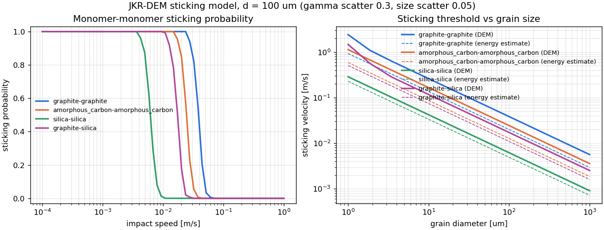
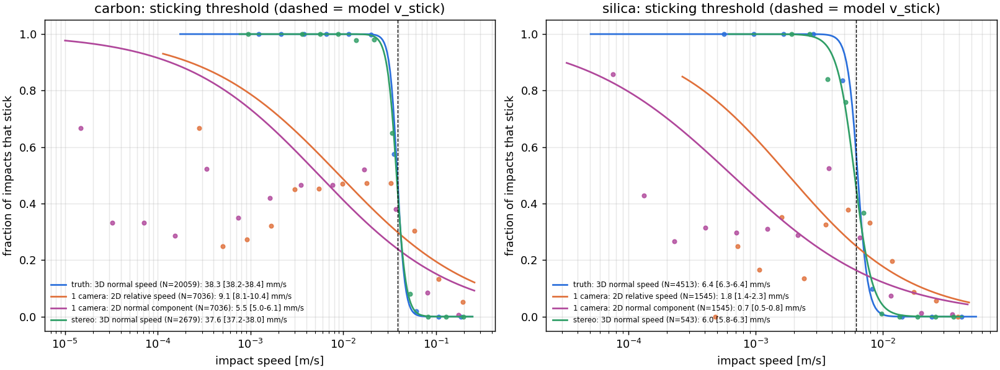
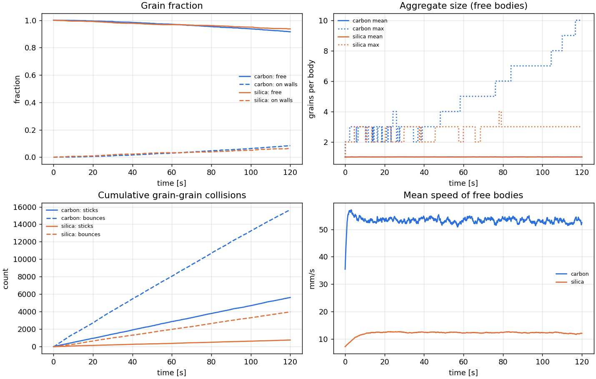
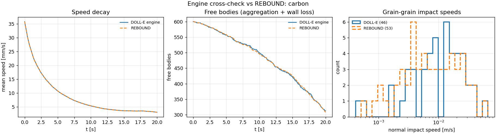

# DOLL-E simulator: user guide

The long reference that used to be the README (moved here in v0.7, 10 Nov 2026): how to use the simulator, the
physics it includes, the results of the example configs, every check, the configuration and the materials. The
README is the short way in; [MISSION_RUNS.md](MISSION_RUNS.md) covers the whole-flight runs and
[HISTORY.md](HISTORY.md) the earlier versions and code reviews.

## Where everything comes from

* **None of the physics comes from REBOUND or LAMMPS.** No code from either
  is copied, translated or called by the simulator, and it runs with both
  unavailable. `tests/test_provenance.py` checks that only
  `extras/dolle_extras/rebound_check.py` imports REBOUND and only
  `extras/dolle_extras/lammps_check.py` (and two scripts in `extras/tools/`)
  import LAMMPS, that the simulator never imports those files, and that a
  simulation runs with both blocked.
* REBOUND is used in one optional file, `extras/dolle_extras/rebound_check.py`. It re-runs
  a simplified chamber in REBOUND as an outside check of our trajectory
  integration and collision bookkeeping. It does not check the sticking
  physics (see [Validation](#validation)). Two of our methods are standard ones
  REBOUND also uses (second-order leapfrog / velocity Verlet, direct-sum
  gravity), and our collision detection is related to its "line" mode, all
  written independently.
* LAMMPS, a widely used open-source particle code, is used in two optional
  files in `extras/`: `dolle_extras/lammps_check.py` compares our 1-D JKR
  contact with LAMMPS's own implementation, and `tools/lammps_contact_check.py`
  runs the optional full-contact engine's 3-D contact law (normal, sliding,
  rolling, twisting, walls) side by side with LAMMPS (see
  [All checks and criteria](#all-checks-and-criteria)).
* The physics comes from published contact-mechanics and aerosol papers,
  textbook mechanics and electrostatics, and some derivations and choices of
  our own. **[PROVENANCE.md](../PROVENANCE.md)** lists every component with its
  source, its place in the code, how it is checked, and what it assumes, each
  marked *published*, *standard*, *derived* or *assumed*. The same table is on
  the website's Sources tab and in `python -m dolle_sim sources`. It is
  generated from `dolle_sim/provenance.py`, and each module's docstring has a
  one-line provenance note. The optional extras have their own table,
  [extras/PROVENANCE.md](../extras/PROVENANCE.md).
* **The weakest link is the material data, and it matters a lot.** With the
  commonly used values, graphite is predicted to stick below ~38 mm/s and
  silica below ~6.2 mm/s. Of that 6.2× ratio, 2.5× comes from the published
  surface energies, 1.7× from the published elastic constants and 1.5× from our
  assumed restitution values (e_dry). The assumed damping also sets most of
  each threshold: without it graphite would stick only below 16 mm/s. Doubling
  a surface energy raises its threshold ~1.8×. Published estimates for dry
  silica in vacuum (Kimura et al. 2015) are up to ten times the commonly used
  surface energy, which would put silica's threshold at 28–42 mm/s, as high as
  graphite's; other work (Kreuzig et al. 2024) finds no such effect for
  hydrophobic amorphous silica. **Measuring this is what DOLL-E is for.** The
  full sensitivity table is at the end of PROVENANCE.md.

## Use it online

**https://thebestproever.github.io/100micron-sim/** (GitHub Pages, served from `docs/`)

* **Run in browser:** the real simulator running locally in your browser via
  [Pyodide](https://pyodide.org) (Python on WebAssembly). Nothing to install and
  nothing is uploaded. You can edit every parameter in a form, every material
  property in a table, or the full config as JSON. Run the pre-flight check or a
  simulation, then get charts, a 3D replay and CSV downloads. Configs can be
  saved and loaded.
* **Sticking calculator:** threshold and sticking-probability curves for any
  material pair, plus inferring γ from a measured sticking speed.
* **Flight:** the launch-load report for editable tubules (dust, sizes, glass,
  stickiness, orientation, deck position), computed in the browser, and the
  stored results of the full-flight scenario runs.
* **Verify:** runs the 26-check physics verification suite in your browser,
  with PASS/FAIL, measured values and tolerances, and shows the stored results
  of the desktop REBOUND cross-check.
* **Sources:** where every part of the physics comes from (generated from
  `dolle_sim/provenance.py`).
* **Replays:** down-sampled 3D replays (500 grains, first 60 s) of the desktop
  flight simulations.

The browser version is the same code without numba. It uses 100 instead of 300
contact sub-steps (sticking thresholds shift by < 0.3%; restitution by up to
~0.004, and up to ~0.02 just above the threshold, where e is small), so keep
browser runs to a few hundred grains and a few seconds; run the full flight
locally. The site's data are refreshed with `python tools/build_site.py` (`--replays --figures` also
rebuild the replays and figures from `results/`). The 3-D page (https://thebestproever.github.io/100micron-sim/sim3d/) is
built by `tools/make_sim3d_replays.py`.

## Commands

```bash
pip install -e .                                                    # or: pip install -r requirements.txt
python -m dolle_sim preflight configs/flight_carbon_vs_silica.json   # seconds: design checks + force budget
python -m dolle_sim run configs/flight_carbon_vs_silica.json         # full simulation (~1 hour on a laptop)
python -m dolle_sim analyze results/flight_carbon_vs_silica          # re-run the camera analysis on saved results
python -m dolle_sim sweep                                            # sticking probability vs speed curves
python -m dolle_sim invert --material graphite --vstick 0.08         # measured v_stick -> effective surface energy
python -m dolle_sim mission configs/mission_quarter_deck.json --loads-only   # launch-load report (seconds)
python -m dolle_sim mission configs/mission_quarter_deck.json --jobs 4       # whole flight, all tubules, one clock
python -m dolle_sim sizes --d10 80e-6 --d50 95e-6 --d90 114e-6 --weighting volume   # supplier percentiles -> sizes
python -m dolle_sim materials                                        # material database
python -m dolle_sim verify                                           # the 26 model checks
python -m dolle_sim sources                                          # where every component comes from
python -m pytest -q                                                  # the main tests (also runs the notebooks)
python tools/checks_table.py                                         # CHECKS.md: every check, criterion and value
```

The optional extras (the v0.6 engine and its 19 checks, the REBOUND and LAMMPS cross-checks, grain sizes from
images, the campaign tools) have their own commands: [extras/README.md](../extras/README.md).

`run` writes to `results/<name>/`:

| file | contents |
|---|---|
| `viewer.html` | interactive 3D replay (open in any browser, works offline): rotate/zoom, colour by material / aggregate size / **spin rate**, collision flashes, **hide grains stuck to the walls**, live impact-speed histogram |
| `sticking_measurement.png` | stick fraction vs impact speed, true 3D vs **what the camera would measure**, logistic fits with 1σ bootstrap errors (sampling noise only; probably too narrow, see Validation) |
| `collision_velocities.png`, `timeseries.png`, `aggregate_sizes.png` | impact-speed histograms, cloud evolution, aggregate growth |
| `<chamber>/collisions.csv` | every impact: time, grains, materials, normal/tangential/relative speed, effective mass, outcome, restitution, plastic yield flag, charges, spins, contact point, collision and dissipated energy, fragments |
| `<chamber>/camera_measurements.csv` | per impact: in field of view / in focus / trackable, true and camera-measured speeds |
| `<chamber>/timeseries.csv`, `trajectory.npz`, `summary.json` | time series, full trajectories, all statistics + pre-flight report |

## Physics included

Every row is detailed, with sources and limits, in [PROVENANCE.md](../PROVENANCE.md). Rows marked **off by
default** are in the code but switched off unless a config switches them on (since v0.7): for the flight
demo config each is at most 2.2% of the 1e-4 g residual acceleration (README, "How realistic is it?").

### Environment (chamber frame, rotating with the payload)
| effect | model |
|---|---|
| Residual microgravity | constant vector (default 1e-4 g, an assumed preset) or a **flight IMU CSV** (`accel_csv`: t, ax, ay, az in g, the apparent acceleration of a free grain, i.e. minus the accelerometer reading) |
| g-jitter / vibration | Ornstein-Uhlenbeck coloured noise (rms, correlation time; a generic model, not a measured spectrum) |
| Payload spin (default **0.0167 Hz = 1 rpm**) | centrifugal + exact Coriolis, any spin axis, chamber offset from the axis; spins keep their absolute angular momentum fixed in inertial space |
| Gravity gradient (tidal), **off by default** (`environment.gravity_gradient`) | (GM/r³)[3(x·ê_up)ê_up − x] about the rocket CG, at flight altitude (~3e-8 g per 10 cm); ê_up (inertially fixed) rotates in the spinning chamber frame |
| Mutual gravity, **off by default** (`forces.self_gravity`) | Newtonian, grain–grain (negligible for 100 µm grains, included for completeness) |
| Gas drag | Stokes + Cunningham slip correction (Davies' empirical constants): exact in the continuum limit, 2.5% below ideal diffuse-reflection Epstein drag in the free-molecular limit; an aggregate's drag is the sum of its grains' (no shielding) |
| Gas torque on spinning grains | continuum 8πμR³ω and free-molecular ≈ (2π/3)ρ v̄ R⁴ω limits, joined by our own interpolation in Kn |
| Brownian motion, **off by default** (`forces.brownian`) | Ornstein-Uhlenbeck kicks consistent with the drag (translation + rotation) |
| Thermophoresis | Waldmann free-molecular law (Kn ≫ 1 only); the 1/(1 + 3.9 λ/L) wall temperature-jump reduction is an uncited approximation |
| Photophoresis, **off by default** (`forces.photophoresis`) | free-molecular law for a conduction-limited sphere, F = (π/3) α J₁ p I R³/(k_p T), derived from kinetic theory (Kn ≫ 1 only); J₁ = absorptivity/2 is an assumption |
| Radiation pressure, **off by default** (`forces.radiation_pressure`) | from the camera illumination; Q_pr ≈ 1 (black) to 0.3 (transparent) is a heuristic |

### Electromagnetic
| effect | model |
|---|---|
| Coulomb | Ewald split: exact short-range pair sum (r < 3 mm) + **long-range space-charge field** from a particle-mesh Poisson solve with φ = 0 on the chamber walls (sine transform, P3M-deconvolved; 1.3% error in the automated check, up to ~5% near the 3 mm split; tolerance 6%). Contact charging leaves the whole cloud with one sign, and nothing screens it at 1 Pa, so the long-range part matters. φ = 0 on the walls matches a grounded conducting inner surface only |
| Polarisation | charge-induced dipole attraction between charged and neutral grains (Clausius-Mossotti; point dipole, underestimates the force very near contact) |
| Image charges | with the space-charge mesh on (the default for charged grains), walls are grounded conductors (factor 1) at all ranges; without it, the wall material's factor (ε−1)/(ε+1) |
| External E-field, **off by default** (`forces.external_e_field`) | uniform, configurable (e.g. biased electrodes) |
| Lorentz force, **off by default** (`forces.lorentz`) | q v×B, Earth's field by default (rotating in the spinning chamber frame) |
| Contact (tribo-)charging | condenser model driven by work-function difference, **saturating** at grain potential ≈ Δφ. The effective work functions of insulators are assumed; same-material charging is not modelled |

### Contacts and collisions

**Event-driven engine (v0.5; the default for `run`, `mission` and the browser).**

| effect | model |
|---|---|
| Adhesion | JKR with snap-on / pull-off hysteresis (Johnson-Kendall-Roberts 1971; Chokshi, Tielens & Hollenbach 1993). JKR holds for graphite (Tabor parameter ~7–14); for 100 µm silica (~1–2) it is an approximation in the JKR–DMT transition that probably overstates the sticking speed |
| Viscoelastic loss | Tsuji-type damping, evaluated with the JKR contact radius (our adaptation), tuned to each material's dry restitution e_dry. The e_dry values are assumed, and the damping sets most of each threshold (graphite 38 mm/s, 16 mm/s without damping) |
| Plastic yield | Thornton & Ning (1998) limiting-pressure loading; unloading on the flattened contact (radius R_p, overlap δ−δ_p), so the pull-off force rises to 1.5πwR_p. Yield starts far above the sticking speeds (0.8 m/s for graphite), so it does not change the thresholds |
| Friction / spin exchange | Coulomb friction cone (μ = 0.3, assumed) at the contact point with the full collision matrix, which couples grain spin to translation; friction impulses that would create energy are replaced by the frictionless impulse |
| Grain-to-grain variability | log-normal scatter of effective surface energy per grain (roughness) and Gaussian scatter of radius |
| Aggregation | stuck grains become rigid aggregates conserving momentum and angular momentum (they spin). Only the normal impact speed decides stick or bounce |
| Fragmentation | Dominik & Tielens (1997) thresholds on the aggregate's own grain–grain bond energy: erosion > 3 N_c E_break, shattering > 10 N_c E_break (derived for sub-µm grains; an extrapolation here). Bonds break only if the energy the bounce actually dissipated pays for them, and fragments separate with what is left (ASSUMED: `contact.fragment_separation`, default 1 = all of it; 0, none, changes the grain-grain sticks of a 6-seed × 100-grain test ensemble from 21 to 22 for silica and 82 to 83 for graphite), so kinetic + bond energy never increases (tested for every impact geometry). The bonds are the grain pairs that stuck, stored when they stick; grains left without a bond become separate bodies |
| Walls | JKR contact with the wall material × `wall_adhesion_factor` (coatings, roughness), optional **vibrating walls** that re-energise the dust. The impact phase is drawn from the flux-weighted distribution, so wall motion can never let a grain through. Grains stuck to a wall move with it, and impacts onto them are flagged and kept out of the grain–grain statistics |

**Optional full-contact engine (v0.6, in `extras/`; run it with `python -m dolle_extras mission`).** Every contact, grain–grain and grain–wall, is integrated at full
stiffness with velocity Verlet at 1/50 of the fastest contact period (shorter inside fast impacts); contact
making and breaking are located inside the step.

| effect | model |
|---|---|
| Normal | JKR with hysteresis (forms at δ = 0, breaks at the end of the stable branch), Tsuji-type damping with the JKR radius, Thornton–Ning plastic flattening (as below) |
| Sliding | spring k_s = 8G*a0 on the tangential displacement (Wada et al. 2007), slips at μ(F_ne + 2F_c); μ measured for silica on glass (0.4), silica on silica (0.6) and graphite on graphite (0.5); graphite on glass assumed (0.5) |
| Rolling | spring k_r = 4F_c/R, limit ξ_crit = h·a0/12 (Dominik & Tielens 1995; Krijt et al. 2014; h = 0.5 assumed, uncertain ~50×); a 100 µm silica grain on clean glass starts to roll at ~1.3 g sideways |
| Twisting | spring (16/3)G·a0³, limit G·a0³/(3π) at zero load (Wada et al. 2007) |
| Aggregates | none as such: stuck grains are ordinary contacts that roll, slide, twist and break under the same law |
| Walls | the same law with the wall material; the tubule is rigid, so wall motion (releases, vibration) is a uniform acceleration of the tubule frame |

### Measurement
A synthetic camera (frame rate, field of view, depth of field, centroid noise,
required free-flight frames) decides which impacts the payload would actually
record, measures their speeds with the noise of a k-frame track fit, and fits
the sticking threshold with bootstrap error bars. The optics are idealised:
orthographic views, no blur, perfect calibration and grain matching, and
perfect classification of impacts (single grains vs aggregates, stick vs
bounce). Three analysis strategies are compared:

| strategy | what is measured | flight run, graphite / silica (truth 38.3 / 6.36 mm/s) |
|---|---|---|
| 1 camera, 2D relative speed | \|projected centroid v_rel\| | 9.1 / 1.82 mm/s: **4.2× / 3.5× too low** |
| 1 camera, 2D normal component | v_rel projected on the imaged line of centres | 5.5 / 0.66 mm/s |
| **2 orthogonal cameras (stereo)** | 3D normal impact speed | **37.6 [37.2–38.0] / 6.01 [5.80–6.31] mm/s** |
| stereo, 1 µm centroiding | 3D normal impact speed | 38.2 [37.9–38.6] / 6.25 [6.08–6.48] mm/s |

In the model, sticking is set by the *normal* impact speed (an assumption;
real tangential motion may also matter). With one camera, oblique impacts
stick at high relative speed and the line-of-sight velocity is invisible, so
the inferred threshold is smeared and biased by an amount that depends on the
launch geometry. **Design recommendation: two orthogonal cameras (or one camera
with a mirror giving a second view), analysed on free monomer–monomer impacts
using the line of centres at contact.** The remaining low bias of stereo comes
from velocity noise (5 µm centroids, 500 fps, 6 frames: ~0.85 mm/s per axis),
which the fit does not correct; it is largest where the threshold is lowest
(silica) and shrinks with 1 µm centroids. A faster camera with the same number
of tracked frames makes it *worse*: velocity noise grows as fps / k^1.5, so
what matters is centroid precision and the tracking baseline.
`python -m dolle_sim analyze <results>` re-runs this analysis (optionally with
`--camera '{"fps": 1000}'` overrides) without re-simulating.

## Keeping grains off the walls

The goal is grain–grain impacts, not wall sticking. In the model, walls stick
whenever a grain hits slower than the wall sticking velocity. Bare glass
(wall sticking speed ~0.8 cm/s for silica, ~2 cm/s for graphite) captures most
grains within a couple of chamber crossings. The example configs keep grains
bouncing *physically*:

1. **Low-adhesion walls**: a fluorinated (FDTS-type) coating on hard glass plus
   bead-blasting (`wall_material: glass_fluorosilane`,
   `wall_adhesion_factor: 0.05`). With these **assumed** values (the coating's
   γ and the 20× reduction from roughening must be measured on the flight
   hardware) wall sticking drops to ~0.4–1.2 mm/s. Soft PTFE is *worse*: it has
   low γ but a huge contact area, and it is a strong tribo-charger.
2. **Vibrating walls**: 200 Hz with 5–25 µm amplitude, so the wall speed is
   comparable to the target impact speed. This replaces the energy lost in
   inelastic bounces and keeps the grains at the speeds you want to probe.
3. `preflight` reports the predicted fraction of wall hits that stick. If you
   set `wall_sticking: "never"` (idealised walls), it warns that the hardware
   must actually achieve it.

The viewer's **"Hide grains stuck to walls"** checkbox removes the wall-bound
grains from the display.

## Results from the example configs

All numbers are for 100 µm grains with the default material database: the
commonly used literature surface energies and elastic constants, and our
assumed restitution values. They predict what the flight would see *if* those
inputs are right (see [Where everything comes from](#where-everything-comes-from)).

**Sticking thresholds (model).** Monomer–monomer, 50% sticking speed with
grain-to-grain scatter (`python -m dolle_sim sweep`): graphite **38.7 mm/s**,
amorphous carbon **24.4 mm/s**, graphite–silica **17.3 mm/s**, silica
**6.2 mm/s**. With these inputs carbon grains stick at ~6× higher speeds
than silica: 2.5× from the published surface energies, 1.7× from the published
elastic constants and 1.5× from our assumed restitution values (see above for
how strongly this depends on the inputs).



**Full flight run** (`configs/flight_carbon_vs_silica.json`: 2 × 2000
grains, 120 s, 1 Pa, 1e-4 g, 1 rpm roll, anti-stick + vibrating walls; about
1 hour on a laptop: ~50 min for the graphite chamber, ~9 min for silica).
**Computed with v0.6.2, all forces on.** Since v0.7 the config switches the
negligible forces off (each at most 2.2% of the residual acceleration). That
the change stays inside the error bars below is ASSUMED, not checked: the run
has not been repeated with the new defaults, and switching Brownian motion off
also changes the random-number stream, so `python -m dolle_sim run` now gives
different numbers, not these exactly:

| | graphite chamber | silica chamber |
|---|---|---|
| grain–grain impacts | 21 281 (5 622 stuck) | 4 728 (758 stuck) |
| wall impacts / stuck | 512 920 / 96 (0.02%) | 132 957 / 114 (0.09%) |
| grains not stuck to a wall after 120 s | 92% | 94% |
| fragmentation events (erosion / shattering), 93% of them dimers broken on fast wall hits | 921 / 4467 | 203 / 513 |
| net cloud charge (contact charging) | +4.9e+07 e (≈ 2.4e+04 e per grain) | +2.1e+07 e (≈ 1.0e+04 e per grain) |
| true threshold (3D normal speed, free monomers) | 38.3 [38.2–38.4] mm/s | 6.36 [6.30–6.42] mm/s |
| **stereo-camera measurement** | **37.6 [37.2–38.0] mm/s** | **6.01 [5.80–6.31] mm/s** |
| single camera, 2D relative speed | 9.1 mm/s | 1.82 mm/s |
| impacts onto wall-bound grains (separate class) | 150 (36 stuck), threshold 30.4 [29.5–31.6] mm/s | 94 (8 stuck), threshold 4.3 [4.0–4.5] mm/s |

The brackets are 1σ bootstrap intervals from sampling noise only; they are
probably too narrow (see [Validation](#validation)), and they do not include the bias from
velocity noise, which is why the silica stereo interval misses the truth.

Impacts onto wall-bound grains see twice the effective mass, so the simple
expectation is the grain–grain threshold /√2 (27.1 / 4.50 mm/s). The grains
that stuck to the walls are on average ~7% stickier than the rest (selection,
measured from the per-grain adhesion factors), which raises that to ~28.8 /
4.75 mm/s. The graphite value is still ~1.4σ above this, and the silica value
rests on only 8 sticks. Fragmentation is dominated by dimers breaking on fast
wall hits, which relies on the extrapolated Dominik & Tielens thresholds.





**Design findings the simulator surfaced** (within the model's assumptions):

1. **Use two orthogonal camera views and ~1 µm centroiding.** In the flight
   run (table above) one camera reads the sticking speed 3.5–4.2× too low;
   stereo with 5 µm centroids reads -1.8% (graphite) and -5.5% (silica) off,
   and 1 µm centroids reduce that to -0.3% and -1.7%. A one-camera bias also
   depends on the impact geometry, so it cannot be calibrated away: the
   deleted colliding-clouds run gave 1.1–1.6× instead
   ([HISTORY.md](HISTORY.md), v0.7).
2. **If the assumed anti-stick performance is achieved, anti-stick vibrating
   walls work.** Fluorinated, roughened glass vibrated at 200 Hz (5–25 µm)
   then catches only 0.02–0.09% of wall hits, 92–94% of the grains are
   still off the walls after 120 s,
   and grain–grain impacts accumulate steadily (~177 per second for
   graphite).
3. **Thermophoresis**: at 1 Pa, each kelvin across a 3 cm chamber drives
   ~3.6e-4 g, 3.6× the residual microgravity. Keep the chamber isothermal to
   ≲ 0.1 K.
4. **Residual 1e-4 g sweeps a resting grain across 3 cm in ~8 s**, and the
   1 rpm roll adds Coriolis accelerations of ~7.5e-4 g at 3.5 cm/s. Both are in
   the simulation, so their effect on the measured impact speeds is included.
5. **Contact charging leaves the cloud one sign** (~2e+04 e per graphite
   grain). The long-range space-charge field is therefore included; charge-induced
   polarisation dominates at contact. Lorentz force and mutual gravity are
   negligible (< 1e-12 g) and are switched off by default since v0.7.

## All checks and criteria

**[CHECKS.md](../CHECKS.md)** lists every check and comparison with what it compares, its pass criterion and the
measured value. It is generated by `tools/checks_table.py` from the result files the checks write, so it
cannot drift from the runs:

| group | how to run | what it covers |
|---|---|---|
| Part 1: 26 model checks | `python -m dolle_sim verify` (also in the browser) | analytic solutions, conservation laws, limits and published data for every model component (table below) |
| Part 2: 19 checks of the optional full-contact engine | `python -m dolle_extras verify` | the 3-D contact dynamics against the 1-D model; momentum, angular momentum and energy; rolling on a wall against the rigid-plastic solution; cluster statics; the vibration synthesis against its spectrum; time-step convergence; slaved rolling (with spin) and slaved clusters (a stuck pair, a grain on another, a single grain) against the full model; sleeping grains against the full model; free-flight hand-off; sleeping with the residual motion against the full model; **the whole regime machinery, and slaved clusters among other moving grains, against runs with every grain in the full model**; clusters asleep at their rolling and twisting limits (constant, shrinking and turning loads, microgravity, creep under the burn and coast loads, a true mechanism, the certificate between steps on the flight loads, the slip of left-over motion at a limit, a load jump), each against the full model (checks 14-19) |
| LAMMPS, 7 set-ups | `python extras/tools/lammps_contact_check.py` | the same contact law term by term: oblique spinning impacts at 3, 30, 300 mm/s, rolling under a ramp, rocking, twisting, 20 grains dropped on a floor (≤ 1e-5; measured ≤ 2.2e-6) |
| LAMMPS, 6 comparisons | `python -m dolle_extras lammps-check` | sticking thresholds, restitution, pull-off (table below) |
| REBOUND, 6 comparisons | `python -m dolle_extras rebound-check ...` | trajectories and collision statistics of a flying cloud (below) |
| unit and regression tests | `python -m pytest -q`; `python -m pytest extras/tests -q` | every module, the readable core against the simulator, the notebooks, the flight timeline, mission runs on both engines, provenance; the extras' own tests |

In every v0.6 mission run the engine also counts, in `mission_summary.json`, the steps it verified, every redo by the
check that asked for it (`redos_speed_bound`, `redos_outside_record`, `redos_rolling_envelope`, `redos_missed_contact`: the safety net) and
the grains that joined the contact dynamics on approach.

## Validation

`python -m dolle_sim verify` runs the 26-check model suite (the same suite runs in the browser app);
`python -m dolle_extras verify` runs the 19 checks of the optional full-contact engine. The model checks:

| test | checks |
|---|---|
| contact: elastic limit, damping, plasticity | energy conservation (e = 1.000), e_dry calibration, Thornton–Ning restitution (no damping; and with damping against e_TN × e_dry, our approximate reference), γ = 0 limit |
| sticking thresholds | DEM threshold = JKR hysteresis estimate without damping; carbon > silica |
| free flight | drag + residual g exact to < 10 nm over 1 s; spinning frame (drag + Coriolis + centrifugal) vs a 10⁻¹² ODE solution of the same equations: < 1 nm at 1 rpm, 2nd-order convergence at 30× the spin rate |
| rigid-body rotation | spinning trimer: angular momentum to 10⁻¹¹, energy error bounded (≤ 1e-4, sampled every step) with no drift; in the rotating payload a spinning grain and an L-shaped aggregate off the spin axis keep their absolute angular momentum fixed in inertial space (10⁻¹³, 2×10⁻¹⁰) |
| collisions | exact normal restitution through the 3×3 impulse matrix for random oblique aggregate impacts, friction cone respected; 2000 eccentric impacts with friction never gain energy; no interpenetration in a dense gas |
| impact energy | every impact measured just before and after it is resolved (grains on spinning chains and L-shaped aggregates from random directions, spinning aggregates on a wall, a closed box of 300 spinning graphite grains; ~1200 impacts, ~95 fragmentations): kinetic + bond energy never increases, no aggregate keeps grains that no longer touch |
| walls | grains forming spinning aggregates against 25 µm / 200 Hz vibrating walls: no grain ever crosses a wall, and the position safety net never has to act |
| conservation | momentum and angular momentum through merging and splitting |
| gas | drag reduces to Stokes in dense gas and is within 2.5% of Epstein in the free-molecular limit; thermophoretic drift matches the textbook free-molecular result to 2.8%; Brownian kicks give equipartition to 1% |
| electrostatics | space-charge solver vs Coulomb's law (1.3% at 1–5 mm along one axis in the check; tolerance 6%); grounded-wall image; charge saturation |
| estimator | the logistic fit recovers known thresholds from synthetic data to < 5%, but its 1σ bootstrap intervals covered the truth in only 9 of 20 trials (nominal 68%), so quoted error bars are probably too narrow |
| bookkeeping | impacts onto wall-bound grains are flagged |
| flight timeline | a grain released during the yo-yo de-spin (Coriolis, centrifugal and Euler forces) vs a 10⁻¹² ODE solution, 2nd-order convergence; a spinning grain keeps its absolute angular momentum (~10⁻¹¹) while the payload spins up to 4.8 Hz; guide timings, roll angle and loads (`tests/test_flight.py`) |
| re-entry | the descent integrator reproduces the closed-form ballistic entry of Allen & Eggers (1958) at 90° and 45°: with gravity off: peak deceleration to ~10⁻⁶, its altitude to < 1 m, v(h) to < 10⁻⁶ (pass limits 10⁻⁵, 5 m, 10⁻⁵); gravity and the NRLMSIS path are covered by tests: parachute and splash impulses equal the momentum changes; the fall reaches 4.6 km at T+460 s and the sea at T+882 s (`tests/test_flight.py`) |
| launch and release | 200 moving grains settle on the aft face under 25 g, none escapes; wall-bound grains come off exactly when the load passes their JKR pull-off force (steady pull and shaker), with the predicted release speeds |
| grain sizes | percentile fits and Hatch–Choate conversion exact; sampling reproduces volume percentiles to 0.5%; image sizing of synthetic micrographs recovers the count (±2) and median diameter (1%) (`tests/test_sizes.py`, `extras/tests/test_sizing_image.py`) |
| provenance | REBOUND is imported only by `extras/dolle_extras/rebound_check.py` and LAMMPS only by `extras/dolle_extras/lammps_check.py` (and two scripts in `extras/tools/`); `dolle_sim` never imports the extras and runs with them blocked; the simulator runs with both blocked; every check and code location named in PROVENANCE.md exists; PROVENANCE.md and the website copy are up to date |

Some components have no automated check against an independent reference:
charge-induced polarisation and short-range image charges, photophoresis,
radiation pressure, gas torque, tidal, Lorentz and external-field forces,
g-jitter, the pair-force limiter, the fragmentation thresholds, the mixing
rules for dissimilar materials, the surface-energy inversion and the camera
model. PROVENANCE.md marks these.

`python -m dolle_extras rebound-check` runs a simplified version of the same
chamber in [REBOUND](https://rebound.readthedocs.io), a widely used N-body code
with its own integrators, gravity and "line" collision detection. Both engines
run point-mass grains with residual gravity, payload spin, drag, mutual
gravity, stick/bounce and static walls; electrostatics, g-jitter, gravity
gradient, thermo-/photophoresis, radiation pressure, Brownian motion and wall
vibration are switched off in both.

* **Part 1 (independent integrator):** over the first 0.2 s, for every grain
  with no collision, REBOUND's high-accuracy IAS15 integrator and ours agree to
  < 1 nm. REBOUND integrates the same equations of motion (we type the
  residual-gravity, centrifugal, Coriolis and drag terms into REBOUND), so this
  checks our integration, not the equations or the drag law.
* **Part 2 (partly independent):** collisions found by REBOUND's detection,
  resolved by *our* JKR contact model plugged in as REBOUND's collision
  resolver (rewound to the true contact time), with our exact drag + Coriolis
  velocity step and our wall handling. Over 60 s with 600 grains, grain–grain impacts, sticks, wall hits and stick
  fractions agree within 1σ of counting noise, and the median single-grain
  impact speed is 7.9 vs 7.5 mm/s for carbon (~55 impacts each) and 2.51 vs
  2.53 mm/s for silica. This checks
  detection and bookkeeping, **not** the contact physics, the material values,
  spin, friction, charging or fragmentation.

See the figure and `results/rebound_check/*.json`.



`python -m dolle_extras lammps-check` compares the contact model with
[LAMMPS](https://www.lammps.org) (Thompson et al. 2022), whose GRANULAR package
has its own, independent JKR implementation with the same force law. LAMMPS
breaks a JKR contact at the maximum tensile force; DOLL-E (like Chokshi et al.
1993) follows the curve to the end of its stable branch. DOLL-E can use either
(`JKRContact(separation="force")`), so the comparison uses LAMMPS's criterion:

| test (undamped, 100 µm grains) | LAMMPS | DOLL-E | difference |
|---|---|---|---|
| silica–silica sticking threshold | 2.684 mm/s | 2.691 mm/s | 0.26% |
| graphite–graphite sticking threshold | 10.94 mm/s | 10.95 mm/s | 0.11% |
| restitution at 2× and 4× the threshold | 0.8654, 0.9696 (silica) | 0.8658, 0.9677 | ≤ 0.002 |
| restitution at 1.2× the threshold | 0.555 (silica), 0.560 (graphite) | 0.550 | ≤ 0.011 |
| pull-off from a borosilicate wall (silica, graphite) | 1.0630e-5, 1.8412e-5 N | 1.5πwR = 1.0616e-5, 1.8387e-5 N | 0.14% (loading-rate lag) |

With DOLL-E's default break criterion the undamped thresholds are 1.42× higher
(3.83 and 15.6 mm/s). Damped collisions are not compared: LAMMPS refuses its
Tsuji damping (the law DOLL-E uses) with JKR, and the damping laws it does allow
with JKR differ from DOLL-E's.

## Configuration

See `configs/flight_carbon_vs_silica.json` (two chambers: graphite vs
silica, isotropic launch). Key blocks:

* `environment`: `preset` (`sounding_rocket`, `spinning_rocket`, `ideal`, `drop_tower`), `pressure_pa`, `gas`,
  `residual_accel_g`, `jitter_rms_g`, `spin_rate_hz`, `spin_axis`, `accel_csv`, `gravity_gradient` (default off),
  `altitude_m`, `electric_field_v_m`, `magnetic_field_t`, `temperature_gradient_k_m`, `illumination`
* `forces`: switch any force on/off. On by default: `coulomb`, `space_charge`, `polarization`, `image_charges`,
  `thermophoresis`. Off by default (since v0.7; each at most 2.2% of the residual acceleration for the flight demo):
  `self_gravity`, `lorentz`, `external_e_field`, `photophoresis`, `radiation_pressure`, `brownian`
  (`dolle_sim/simulation.py: FORCES_OFF_BY_DEFAULT`);
  `long_range_cutoff_m` (Ewald split radius), `long_range_update_every` (pair forces, default and example
  configs: every step), `space_charge_update_every` (mesh solve, default every 25 steps),
  `photophoresis_accommodation`
* `contact`: `friction_coefficient`, `wall_sticking` (`jkr`/`never`/`always`), `contact_charging`, `fragmentation`,
  `fragment_separation` (0-1, default 1: the share of a break-up's left-over dissipated energy the fragments fly
  apart with; ASSUMED)
* `camera`: `view_axis`, `fps`, `fov_m`, `depth_of_field_m`, `position_noise_m`, `track_frames`
* `materials`: override any property of any material, or define new ones
* `chambers[]`: `size_m`, `wall_material`, `wall_adhesion_factor`, `wall_vibration`, offsets from the spin
  axis/CG, `release` (shaker or kick windows), and `particles[]` groups (`material`, `count`, `radius_m`,
  `radius_rel_sigma` or `size_distribution`, `surface_energy_log_sigma`, `charge_e_mean/sigma`, `spin`,
  `region_m`, `velocity` isotropic or jet, `initial_state: {"type": "settled", "face": "-z"}`)
* `size_distribution`: `{"type": "sieve", "min_m", "max_m", "fraction_in_range"}`, `{"type": "percentiles",
  "d10_m", "d50_m", "d90_m", "weighting": "volume"}` (laser diffraction) or `"number"` (microscopy),
  `{"type": "lognormal", "median_m", "gsd", "weighting"}`, or `{"type": "measured", "diameters_m" | "csv"}`
  (see `dolle_sim/sizes.py`)

A **mission** config (`configs/mission_quarter_deck.json`) instead lists `tubules[]` (`inner_size_in`,
`orientation` standing/lying, `deck_position_m`, `wall_material`, `dust`, `release`), a `flight_profile`
(timeline; see `dolle_sim/flight.py`), `gas`, `simulate_from_s`, `engine` (`"v05"`, the default, or `"full"`,
the optional v0.6 engine in `extras/`, which only `python -m dolle_extras mission` runs), `gravity_gradient` (default off), and named `scenarios` of overrides
([MISSION_RUNS.md](MISSION_RUNS.md)).

## Materials

`silica`, `forsterite`, `alumina`, `graphite`, `amorphous_carbon`, `carbon_silica_50_50`, `water_ice`, and
the wall materials `glass_borosilicate`, `glass_soda_lime`, `fused_silica_glass`, `glass_silanized`,
`glass_bk7`, `glass_fluorosilane`, `sapphire`, `aluminum_6061`, `ptfe`. The four tubule glasses take their
elastic constants from the SCHOTT DURAN / BOROFLOAT 33 and Corning HPFS 7980 datasheets, and their
stickiness from works of adhesion measured for ~90 µm glass beads on glass in air: w = 0.045 J/m² for clean
glass and 0.022–0.030 J/m² for silanised glass (Sansao et al. 2021; Zafar et al. 2014). The silanised value
was measured for silanised beads on silanised glass; untreated grains on a silanised wall, and graphite on
any glass, have not been measured (the combining rule gives the model's values). Each has density,
modulus, Poisson ratio, surface energy, restitution, work function, permittivity, yield pressure, thermal
conductivity and absorptivity, with notes saying which values come from papers
(`python -m dolle_sim materials`). Only the silica γ, E and ν, the graphite γ, E, ν and ρ, and the
water-ice γ, E and ν are taken from the cited papers; everything else, including every e_dry, is a
representative value we chose.

## How realistic is it?

It includes every effect we could identify that matters for 100 µm grains at
mm/s–cm/s speeds in a 0.1–10 Pa chamber, plus several that turn out
negligible (mutual gravity, the Lorentz force and external field, photophoresis,
radiation pressure, Brownian motion, the gravity gradient), which are in the code
but switched off by default. The pre-flight force budget shows every one of them
for *your* configuration, marks the switched-off ones and warns when one would
matter.

What no simulation can supply is the **material parameters of your actual
powder**: surface energy, yield pressure and dry restitution. Real grains are
rough, irregular and possibly contaminated, so literature γ values can be off
by a factor of several, and for silica in vacuum the literature itself spans
~10×. That is exactly why the experiment is worth flying. A concrete example:
for 1.2 µm silica spheres shot at a flat silica or glass target this model
gives 0.27–0.28 m/s, but Poppe, Blum & Henning (2000) measured about 1.2 m/s,
4.3–4.5 times more (notebook 00). (The often-quoted 0.25 m/s is for two free
grains and would give 4.9 times, but the experiment used a flat target.)
Theory with literature parameters can be off by several times, so the
predicted numbers above are design guidance, not the answer.

The intended workflow:

1. Design with the literature values (this repo).
2. Calibrate γ and e_dry with ground tests (drop tower, or low-speed tabletop
   impacts on a substrate). `invert` turns a measured sticking velocity into
   γ_eff.
3. After flight, fit the measured sticking curve. Compare carbon vs silicate γ_eff
   and their trend with work function / electron affinity.

Remaining approximations: grains are smooth spheres, and JKR is an approximation
for silica at this size (Tabor parameter ~1–2). The rolling hysteresis h and the
rolling and twisting damping (Q = 100) are assumed (PROVENANCE.md). The
event-driven engine (the default) keeps two more: aggregates are rigid between
impacts (no rolling restructuring; during an impact the contact sees the whole
aggregate's effective mass, and only the normal impact speed decides stick or
bounce), and fragmentation uses thresholds extrapolated from sub-µm grains; wall
grains are held in place until they are pulled off. The optional full-contact
engine (`extras/`) has no further contact approximations: every contact rolls,
slides, twists and breaks under the full law, and its rest, rolling and
free-flight treatments are verified every step. Thermo- and photophoresis use free-molecular formulas (valid at
Kn ≫ 1; pre-flight warns below Kn = 10), and photophoresis ignores shadowing
(the cloud is optically thin). Gas flow is not simulated (free-molecular
regime, Kn ≈ 100). For the long-range field the chamber walls are grounded
conductors. The flight environment presets are representative, not vehicle
data; the mission timeline uses the launch provider's envelope values, not a
measured flight history. The tubule is rigid (its structural modes are not
modelled), and burn vibration is applied only in the `launch_vibration`
scenario, at the ground-test level, as an upper bound (no measured flight
spectrum is public). Every such assumption is listed in [PROVENANCE.md](../PROVENANCE.md).

## Key references

The full list, with what each is used for, is in [PROVENANCE.md](../PROVENANCE.md).
Johnson, Kendall & Roberts (1971) Proc. R. Soc. A 324, 301 · Chokshi, Tielens & Hollenbach (1993) ApJ 407, 806 ·
Dominik & Tielens (1997) ApJ 480, 647 · Thornton & Ning (1998) Powder Technol. 99, 154 ·
Tsuji, Tanaka & Ishida (1992) Powder Technol. 71, 239 · Dullweber, Leimkuhler & McLachlan (1997) J. Chem. Phys. 107, 5840 ·
Davies (1945) Proc. Phys. Soc. 57, 259 · Waldmann (1959) Z. Naturforsch. 14a, 589 · Rohatschek (1995) J. Aerosol Sci. 26, 717 ·
Matsusaka et al. (2010) Chem. Eng. Sci. 65, 5781 · Kimura et al. (2015) ApJ 812, 67 · Kreuzig et al. (2024) A&A 688 ·
Wang et al. (2015) Nat. Commun. 6, 7853 · Poppe, Blum & Henning (2000) ApJ 533, 454 · Rein & Liu (2012) A&A 537, A128 (REBOUND) ·
Thompson et al. (2022) Comput. Phys. Commun. 271, 108171 (LAMMPS) · RockSat User Guide 2026 ·
Sansao et al. (2021) Powder Technol. 384, 267 · Zafar et al. (2014) Powder Technol. 264, 236 · Rice (1944) Bell Syst. Tech. J. 23, 282 ·
Hatch & Choate (1929) J. Franklin Inst. 207, 369 · van der Walt et al. (2014) PeerJ 2, e453 (scikit-image).
