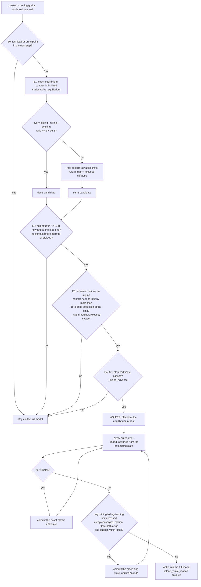

# Resting clusters that sleep at their contact limits: design record

This folder is the complete record of one engine change, from the measurement that motivated it to the code and the
checks. Every stage is kept as it was written, so anyone can follow each decision, see what was rejected and why, and
check the final logic against the code.

**Status (31 Oct 2026): implemented, verification in progress.** The code is in `dolle_sim/engine.py`,
`dolle_sim/statics.py` and `dolle_sim/loads.py`. All 13 existing engine checks and the new unit tests of the helper
functions pass. The six checks that compare the new treatment against the full model (14-19, listed below) are not
written yet, so the campaign will not run on this code until they pass.

## 1. The problem, as measured

The v0.6 engine lets a resting cluster of grains "sleep" (stop being integrated) only when every contact is far from
its limits: at the cluster's exact equilibrium, every load ratio (normal pull-off, sliding, rolling and twisting load,
each divided by its limit) had to stay at or below 0.90 to enter and 0.98 to stay. That test is a linear-response
prediction, and a linear prediction cannot tell whether a contact sitting exactly at its limit will slide or roll a
little further. So the test kept such contacts out.

On 29 Oct 2026 the campaign's own saved states (nominal scenario, 100 grains per tubule) were loaded and every
cluster the engine refused to put to sleep was examined (the numbers are in [01_brief.md](01_brief.md)):

* nearly all computing went to clusters that were **static** (speeds 1e-13 to 2e-9 m/s), integrated by the full
  contact model at 5-18 ns steps (4e7-1.2e8 steps per flight-second);
* in the boost and coast (8 g along the walls from the spin), their worst contact sat **at its rolling limit** (ratio
  >= 0.999), so the 0.90 entry test could never pass;
* in microgravity, an edge grain refused at a twisting ratio of 0.962 and a 3-grain bridge at a rolling ratio of
  0.926; these would have stayed in the full model for the remaining 800 s of flight;
* cost: 1e3-1e4 s of computing per flight-second in the coasts, days per tubule in microgravity, weeks for the
  campaign.

A contact at its limit is not moving. It changes only if the load pushes it further along its limit (plastic flow) or
if left-over vibration ratchets it. The task was to let such clusters sleep while keeping every result **exact** (the
full model would change nothing) **or bounded** (any change it would make is computed, reported and kept below a
published limit).

## 2. How the design was made

| step | file | what happened |
|---|---|---|
| 1 | [01_brief.md](01_brief.md) | One brief for everyone: the code, the measurements, the standard (exact or bounded, verified against the full model). |
| 2 | [02_design_A_unloading_certificate.md](02_design_A_unloading_certificate.md) | Independent design A: prove the load cannot rise past the limit over the step (smallest change). |
| 3 | [03_design_B_nonlinear_verification.md](03_design_B_nonlinear_verification.md) | Independent design B: do not trust the linear prediction near a limit; evaluate the real contact law at the predicted state (Newton certificate). |
| 4 | [04_design_C_risk_first.md](04_design_C_risk_first.md) | Independent design C: list every way sleeping at a limit could silently differ from the full model, then design against each. |
| 5 | [05_synthesis.md](05_synthesis.md) | Read the code, judged each design's claims against it, took the best of each (section 8 lists what was wrong in each design). |
| 6 | [06_critique.md](06_critique.md) | Adversarial review of the synthesis: findings A1-E5. Two would have let the stated bound be exceeded (A1, A2), one would have made the measured clusters never sleep (C1). Its "corrected criteria" are what was implemented. |

None of the three designers saw the others' work. The synthesis and the critique were each done by a fresh reader with
only the code and the previous stage.

## 3. The logic, as implemented

Two treatments, decided freshly every step from the same calculation:

* **Tier 1, static (exact).** Lift the contact limits (make them infinite), find the exact elastic equilibrium at the
  end of the step and halfway, and bound how far every contact load can stray between those samples. If even the
  worst case stays within every sliding, rolling and twisting limit (to 1 part in 1e6), the real contact law never
  reaches a limit during the step, so it changes no plastic variable. The cluster's new state is then exactly the full
  model's quasi-static state.
* **Tier 2, creep (bounded).** If the elastic prediction does cross a limit, the cluster is advanced with the real
  contact law's own rule for flow at the limit (the kernel's "return map"), solved to equilibrium. The step is done
  twice (one step, then two half steps) and the difference measures the error. Every error term is added up per
  cluster, and the cluster is woken when the total reaches 1% of the deflection at the limit (`island_budget_rel`).

Anything else wakes the cluster into the full model, and the reason is counted (`island_wake_<reason>` in the run's
`n_events`).



### Entry: `FullContactSim._try_sleep_island` (engine.py)

| test | what it checks | why |
|---|---|---|
| E0 | No fast load (release waveform, vibration) or load breakpoint in the next step; the contact system is the touching contacts plus every member pair or member-wall pair closer than `island_gap_m` (2 x the capture distance) as inactive contacts (`_island_near`); the elastic stiffness factorises. | Fast loads are resolved only by the full model. The inactive pairs let a solve notice a contact about to form (critique B1). |
| E1 | Exact equilibrium of the current load from the full model's state (Newton with the limits lifted; per-degree-of-freedom tolerances, `_island_tols`). Tier 1 if all sliding/rolling/twisting ratios are <= 1 + `island_tol_rel` there, else the real contact law's return map with the consistent tangent (`_island_tangent`, `statics.released_stiffness`) places it as tier 2. A mechanism or no convergence refuses. | The placed state must be an exact equilibrium of the real contact law (critique C1: the plain elastic iteration stalls exactly for the piles at their limits). |
| E2 | Pull-off ratio <= 1 - `sleep_margin` now and at the step end (load taken just before any breakpoint), including the left-over motion's largest effect; nothing broke, formed or yielded in the solve. | A normal contact near pull-off is a genuine instability. |
| E3 | Left-over energy E_res = kinetic + elastic deviation + what the step's load change can leave as an oscillation (`_island_adiabatic`). For every contact component near its limit, its slip bound in the **released** system (springs at their limits removed, `_island_ratchet`) must stay below `island_ratchet_rel` (1e-3) of its deflection at the limit. | Critique A1: at a limit the external load, not the left-over energy, does the plastic work, so the slip equals the left-over motion's amplitude in the structure without that spring. The earlier bound E/cap was low by 1e2-1e5. |
| E4 | The first step's certificate (`_island_advance`) passes on the candidate; for tier 1 the ratios extrapolated over 20 steps stay inside the limits, otherwise the cluster enters as tier 2. | Do not place a cluster that would wake at once; only an accepted candidate is written into the simulation state (critique D1). |

### Every step: `FullContactSim._island_advance` (engine.py)

The deviation bound for each contact component k is

`D_k = rn_k (||dF_chord|| + ||r_1|| + ||r_0|| + ||f_dyn||) + 2 |lam_mid - (lam_0 + lam_1)/2|_k`

where `rn_k` is the row norm of J K^-1 (`_island_row_norms`, translational and rotational parts separately);
`dF_chord` is how far the loads can stray from a straight line between the step's ends (`Loads.chord_dev`,
`Loads.spin_chord`, critique A4); `r_1`, `r_0` are the Newton residuals at the end and start (the start including the
change of the long-range forces since the last commit, critique A7); `f_dyn` covers the forces the slow drift's own
dynamics would need (`_island_fdyn`); and the last term is the path's measured deviation from the straight line,
taken at mid-step and doubled (critique A3). The `rn` terms are doubled while the stored tangent is not refreshed.

Loads at the end of a step are taken just before any breakpoint (`Loads.accel(T, side="-")`, critique A2). So a
cluster certified up to a load jump is committed at the pre-jump equilibrium, and the full model resolves the jump.

Wake reasons (counted as `island_wake_<reason>`): `fast`, `loading` (a limit crossed with creep off), `pulloff`,
`break`, `yield`, `newcontact`, `mechanism`, `newton`, `motion` (creep moved more than `island_motion_m` = 1e-9 m in a
step), `flow` (more than `island_flow_max` = 5% of the deflection at the limit in a step), `twist` (a twist the
contact law would resolve from the sign of a round-off rate, critique B3), `path` (the two half steps differ from the
whole step by more than `island_path_tol` = 1e-3 of the deflection at the limit), `budget`, `approach` (a grain in the
full model came within twice the capture distance of a sleeping member).

Bounds kept per cluster and reported in `n_events`: `island_bound_xi` (largest accumulated bound relative to the
deflection at the limit; the budget caps it at 1e-2), `island_flow_m`, `island_snap_rel`, `island_wake_transient_m`.

## 4. Each critique finding and where the code handles it

| finding | what could go wrong | handled by |
|---|---|---|
| A1 | ratchet bound low by 1e2-1e5 | `_island_ratchet` (released system via `statics.released_stiffness`), entry E3 |
| A2 | at a breakpoint the committed state was the post-jump equilibrium, dropping the jump's transient | `Loads.accel(..., side="-")`, `Loads.omega_dot(..., side="-")`; every step-end load in `_island_advance` |
| A3 | stale tangent dominated the nonlinearity term | mid-step solve, term `2 |lam_mid - (lam_0 + lam_1)/2|` in `_island_advance` |
| A4 | kink term off by 2 | `Loads.chord_dev` (`|Delta slope| l / 4`) |
| A5 | force and torque tolerances mixed | `_island_tols` (per degree of freedom) |
| A6 | no cumulative limit on tolerated error | `bnd["total_rel"]` and wake `budget` (`island_budget_rel`) |
| A7 | long-range force change between steps ignored | `r_0 = r_ref + Delta F_lr` in `_island_advance` |
| B1 | contact forming inside a drifting cluster undetected | `_island_near` (inactive pairs), wake `newcontact` |
| B2 | drifting clusters assumed static by the other grains' motion bounds | `s_isl` in `_watch` (join and step limit), `_capture_times`, `_early_exit`, `_slv_obstacles` (`_drift`) |
| B3 | twist resolved from the sign of round-off | `statics.twist_ambiguous`, wake `twist`; option `twist_continuity` (off, ASSUMED if switched on) |
| B4 | yield test woke contacts already flattened | yield read from the contact law's own transitions in `statics.solve_equilibrium` |
| C1 | plain iteration stalls for piles at their limits | `_island_tangent` (released-stiffness Newton) |
| C2 | motion limit too tight for early creep | `island_motion_m` = 1e-9 m (with `s_isl` everywhere) |
| C3 | tier-1 candidates about to flow refused instead of creeping | E4 falls through to tier 2 |
| C5 | ratchet test applied to components far from their limits | `near` mask in `_island_ratchet` |
| D1 | a refused cluster's state altered | entry and step work on candidate arrays; written only on acceptance |
| D2 | entry certificate counted as a sleeping step | `count=False` at entry |
| D5 | a broken contact's history committed by the fallback placement | `_wake_island` hands the committed state over instead |
| D6 | pull-off chatter at entry | 20-step extrapolation includes the pull-off ratio (clusters and single grains) |
| D8 | islands saved by the previous code version | `_island_upgrade` (ratchet bound recomputed) |
| C4, D3, D4, E1-E5 | measurements, wording, test budget, the checks themselves | open: diagnostics on the campaign's states, README wording, checks 14-19 |

### Where the implementation differs from the critique (each is stated in the code's docstrings)

1. Row norms are taken separately over translational and rotational degrees of freedom (`_island_row_norms`). One
   combined norm mixed torque sensitivities with force residuals and overstated a 1e-16 N residual as 4e-4 of a
   rolling limit, which would have pushed every cluster at its limit into creep.
2. The energy a step's load change can leave behind is multiplied by `min(1, 4/(omega_min H)^2)`
   (`_island_adiabatic`): an undamped linear mode whose equilibrium moves over a time H keeps at most this fraction as
   oscillation. **This factor is the implementer's own derivation and has no outside source; it must be confirmed by
   a check against the full model (planned in check 18). It also needs review: the lowest frequency is taken from the
   elastic stiffness, and the released system at a limit is softer.**
3. The previous 1%-of-remaining-margin test for left-over motion is kept for contacts that are not near a limit (its
   exact linear-response tracking, `_linres`, is still used there).
4. At entry, "near a limit" means within the sleep margin (2%), because the step's deviation bound is not known yet.

## 5. What is verified now, and what is not yet

| verified | how |
|---|---|
| The helper functions (`statics.lift_caps` ... `statics.twist_ambiguous`): the lifted law is bit-identical to the real one below the limits; the real law's return map at a limit; the released stiffness; the equilibrium solver converges, detects mechanisms and contact breaks | `tests/test_statics_caps.py` (10 tests) |
| Left limits at breakpoints; the chord-deviation bound holds on 50 random steps over the whole flight profile, including steps containing a kink; it is exact on the parachute and splash pulses | `tests/test_loads_chord.py` (6 tests) |
| All 13 existing engine checks still pass on the new engine (contact law vs 1-D model, conservation, rolling, cluster statics, vibration, time step, slaved rolling, exact sleep, hand-off, regimes, linear-response sleep, slaved clusters) | `python -m pytest tests/test_full_engine.py -k full_engine_check` (13 passed in 62 s) |

Not yet verified (planned before the campaign restarts):

| check | compares | criterion (from the critique) |
|---|---|---|
| 14 `cap_sleep_vs_dem` | a grain in an edge and a 3-grain corner cluster at their rolling limits, 30 ms, engine vs full model at two step sizes, under constant, shrinking and turning loads | asleep >= 90% of steps; positions and spring states within 3x the full model's own step error plus the reported bound |
| 15 `cap_twist_microgravity` | edge grain with locked-in twist at 0.96 of its limit, microgravity, 0.5 s | sleeps; twist changes by <= 1e-6 of its limit in both; positions within 3x step error + 1e-12 m |
| 16 `creep_island_vs_dem` | 2- and 5-grain piles under the burn's growing load and the coast's shrinking one; a true mechanism | creep steps >= 90%, <= 10 Newton iterations per step, spring states within step error + reported bound; the mechanism wakes |
| 17 `between_sample_bound` | the certificate's worst case vs the exact ratio on a 20-point grid inside every step (drag decay, splash, spin-up, a kink, the de-spin knot) | no violation |
| 18 `ratchet_released_bound` | measured permanent slip of a capped grain with prescribed left-over energy vs the released bound (and the old E/cap bound) | released bound never exceeded; old bound exceeded at least once |
| 19 `island_across_breakpoint` | a capped cluster across the de-spin knot vs the full model | committed at the pre-jump equilibrium; within 3x step error |

Measurements the implementers made against the full model while coding (scratch scripts, not yet part of the suite):
a pair of grains held at its rolling limits slept under constant load with positions equal to the full model's to
1.5e-17 m; under a growing sideways load it crept (17 creep steps) and its rolling springs matched the full model's to
6e-14 m, within the full model's own step error of 6.3e-14 m; a flying grain hitting a sleeping 3-grain row woke it
with no missed contact, and the final positions matched the full model to 2.8e-11 m (step error 7e-9 m).

## 6. How to check it yourself

```bash
python -m pytest tests/test_statics_caps.py tests/test_loads_chord.py -q
python -m pytest tests/test_full_engine.py -q
python -m dolle_sim verify --json results/verify_all.json
```

Every result file the checks write is turned into [CHECKS.md](../../../CHECKS.md) by `tools/checks_table.py`.
