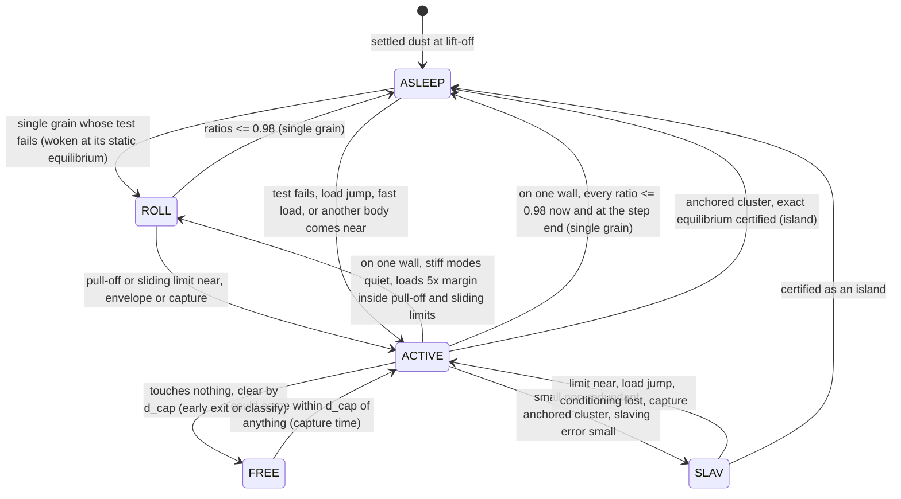
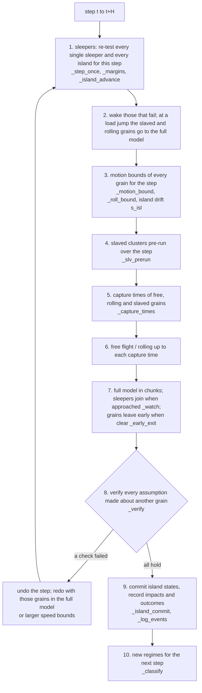

# How the v0.6 engine decides: every decision, its test, its reason, and the check that verifies it

This is a map of the full-contact flight engine (`extras/dolle_extras/engine.py`, class `FullContactSim`) for readers who want to
follow or audit its logic without reading 3000 lines of code. For every decision the engine makes it gives the test
as the code applies it, the function that applies it, why it is there, whether the result is **exact** (the full
contact model would do the same) or **bounded** (any difference is limited by a stated, computed quantity), and the
check or test that verifies it. Function names are written `module.function`; the test
`extras/tests/test_engine_logic_doc.py` fails if any function or check named here stops existing, so this page cannot
silently go out of date. Checks are named `check:<id>` (their results, criteria and measured values are in
[CHECKS.md](../../CHECKS.md)); checks still being written are marked `planned:<id>`.

The design history of the newest part (clusters that sleep at their contact limits) is in
[design/at-limit-sleep/](design/at-limit-sleep/README.md). Where every model and number comes from (papers, data,
assumptions) is in [PROVENANCE.md](../PROVENANCE.md).

## Words used below

| term | meaning |
|---|---|
| ratio | a contact load divided by its limit: pull-off (tensile normal load / pull-off force F_c), sliding (tangential force / mu_t F_ncrit), rolling (rolling pseudo-force / mu_r F_ncrit), twisting (torque / mu_tw F_ncrit), with F_ncrit = abs(F_ne + 2 F_pull) as in `dem.contact_force` |
| margin | `sleep_margin` = 0.02: a sleeper wakes when a ratio exceeds 1 - margin = 0.98 |
| d_cap | the capture distance, 1e-7 m: a grain enters the full model before its gap to anything can fall below it |
| H | the outer step (4 ms in the coasts; shorter where loads change fast, see D1) |
| full model / DEM | the full-stiffness soft-sphere contact dynamics of `dem.py`, at about 1/50 of the fastest contact period (5-25 ns) |
| island | a sleeping cluster of grains (several grains, or one grain touching two or more walls) |

## 1. The five regimes

Every grain is in exactly one regime at any time.



| regime | what integrates it | exact or bounded | verified by |
|---|---|---|---|
| FREE | free flight in the rotating frame with drag and Coriolis (`engine.FullContactSim._free_flight`, the integrator of `simulation.py`) | the regime decision is exact: a grain is free only while no other body can reach it within d_cap; the flight itself is checked against analytic solutions | `check:engine_handoff`, `check:free_flight`, `check:rotating_frame`, `check:spin_rotating_frame` |
| ACTIVE | the full model (`engine.FullContactSim._dem`, `dem.run_steps`) | the reference: LAMMPS's granular contact law term by term, time step converged | `check:dem_vs_1d`, `check:dem_conservation`, `check:time_step`, LAMMPS comparison in CHECKS.md |
| ROLL | one grain on one wall with its stiff normal and sliding modes held quasi-static (`roll1.run`) | bounded: slaving error of order (soft / stiff frequency)^2 | `check:roll1_vs_full` (<= 3e-5 of the rolled path) |
| SLAV | a small anchored cluster with all stiff modes quasi-static (`slaved.run`) | bounded: the same slaving error, checked by an indicator at entry | `check:slaved_vs_full`, `check:engine_slaved` |
| ASLEEP | nothing: the grain or cluster is static, its test re-evaluated every step | single grain: exact (elastic, no plastic variable can change); island: tier 1 exact, tier 2 bounded and budgeted | `check:sleep_exact`, `check:cluster_statics`, `check:linres`, `check:engine_regimes`; `check:cap_sleep_vs_dem` ... (section 3.6) |

## 2. One outer step, in order

`engine.FullContactSim.run` repeats: if everything is asleep, skip ahead (D21); otherwise take one verified outer step
(`engine.FullContactSim.step`) of size H (D1).



## 3. The decisions

### 3.1 Step size and the verified step

| # | decision | test, as applied | function | why | exact / bounded | verified by |
|---|---|---|---|---|---|---|
| D1 | outer step H | H = dt_s (4 ms); with free grains under launch loads, dt_launch scaled to the load (0.5 ms at 25 g); at most 0.02 rad of payload roll per step; inside a release waveform or vibration at least 40 steps per cycle of its highest frequency; every step ends exactly at the next load breakpoint; just after a breakpoint a 5e-5 s step | `engine.FullContactSim._outer_dt` | no step straddles a load jump; free flight keeps its v0.5 accuracy; kHz loads resolved | step choice only (every regime's own accuracy is checked separately) | `check:engine_regimes`, `check:engine_slaved` |
| D2 | is the step valid? | after the step: every full-model grain's observed speed <= the speed bound the others assumed for it; no contact formed outside the full model (an overlap with no contact record); every rolling grain stayed inside the envelope others assumed; every grain that entered the full model mid-step was clear of every grain advanced outside it | `engine.FullContactSim._verify`, `engine.FullContactSim._missed`, `engine.FullContactSim._missed_end` | each grain's treatment relies on bounds for the others; they are checked, not trusted | exact: a failed check undoes the step | `check:engine_regimes`, `check:engine_handoff`; tests `test_contact_formed_outside_the_dem_is_redone`, `test_grains_leaving_together_have_their_speed_bounds_checked` |
| D3 | redo | undo to the step start; the grains named go into the full model from the start (or the speed bounds are scaled by the observed excess x1.25); up to 64 attempts, else the run stops with an error; every redo counted by reason (`redos_missed_contact`, `redos_speed_bound`, `redos_rolling_envelope`, `redos_outside_record`) | `engine.FullContactSim.step`, `engine.FullContactSim._snapshot`, `engine.FullContactSim._restore` | the same check cannot fail twice for the same grains | exact | same as D2 |

### 3.2 Motion bounds (what each grain may assume about the others)

| # | decision | test, as applied | function | why | exact / bounded | verified by |
|---|---|---|---|---|---|---|
| D4 | how far a grain can move in H | abs(v) H + a_max H^2/2 + 1e-9 m, a_max bounding every body force over the step: the loads' interval bound, centrifugal and Euler terms out to the farthest point of the tubule, long-range forces, and the velocity-dependent Coriolis and drag terms through a Gronwall factor exp(c H) | `engine.FullContactSim._motion_bound`, `loads.Loads.accel_bound` | capture times and list builds rest on it | exact as a bound (D2 checks the speeds actually reached) | `check:engine_regimes` |
| D5 | a rolling grain's envelope | v H + (5/7) max(a_t - a_roll, 0) H^2/2 + its rocking deflection (2 xi_crit) + 1 nm; no direction assumed | `engine.FullContactSim._roll_bound` | a rolling grain may turn | exact as a bound (checked every rolling step: `redos_rolling_envelope`) | `test_rolling_grain_wall_bound_assumes_no_direction` |
| D6 | a sleeping island's drift | s_isl = abs(du)_inf + the step's curvature deflection + 1e-12 m (0 for a single sleeper) enters every bound that treats a sleeper as static | `engine.FullContactSim._drift`, `engine.FullContactSim._watch`, `engine.FullContactSim._capture_times`, `engine.FullContactSim._early_exit`, `engine.FullContactSim._slv_obstacles` | creeping islands move (by <= 1e-9 m per step) | exact as a bound | `check:cap_sleep_vs_dem` |
| D7 | speed bound of a grain in the full model | the fastest grain it could meet during H (groups whose reaches overlap, grown until stable) x sqrt(m_max/m_min) (the most a collision can give) + the group's acceleration bound x H | `engine.FullContactSim._speed_bounds` | a slow cluster far from fast grains keeps a slow bound | exact as a bound (D2 checks it) | `test_grains_leaving_together_have_their_speed_bounds_checked` |

### 3.3 Entering and leaving the full model

| # | decision | test, as applied | function | why | exact / bounded | verified by |
|---|---|---|---|---|---|---|
| D8 | when a free, rolling or slaved grain joins the full model | at a lower bound on the earliest time it could come within d_cap of a wall or another grain: straight-line relative motion plus curvature for free and sleeping grains, the envelope for rolling ones, only a speed bound (no direction) for grains in the full model | `engine.FullContactSim._capture_times` | no contact can form outside the full model | exact (a contact formed outside it is caught by D2) | `check:engine_handoff`, `check:engine_regimes` |
| D9 | when a sleeper joins the full model | a grain in the full model comes within 2 d_cap + s_isl of it; a cluster joins whole, at its state for the current load, at rest | `engine.FullContactSim._watch`, `engine.FullContactSim._wake`, `engine.FullContactSim._wake_island` | the full model resolves the approach from beyond d_cap | exact | `check:engine_regimes` (3 sleepers joined on approach) |
| D10 | leaving the full model mid-step | a grain touching nothing (or one wall only, to the rolling model) leaves for free flight up to a lower bound on its next capture time, if that is at least 1000 full-model steps away; it rejoins then (times rounded down to a grid of 250 steps) | `engine.FullContactSim._early_exit` | free grains near a collision need not wait for the step end | exact as a bound (speed bounds recorded and checked, D2) | `check:engine_handoff` (leaves and rejoins), `test_grains_leaving_together_have_their_speed_bounds_checked` |
| D11 | full-model time step | the fastest contact period (normal 1.2 E* a0, sliding 8 G* a0 with the rotational coupling, smallest grains, every pairing) / 50; shorter in fast impacts: Hertz contact time 2.87 (m*^2/(R* E*^2 v))^(1/5) / 50 | `engine.FullContactSim._contact_dt`, `engine.FullContactSim._hertz_dt`, `engine.FullContactSim._dem` | resolves the stiffest contact oscillation | converged: halving the step changes the rolled distance by 3.3e-7 | `check:time_step` |
| D12 | neighbour lists | candidate contacts within a skin of half the smallest radius; a grain may move min(half the skin, its clearance to the nearest sleeper - 2 d_cap) before the lists are rebuilt | `engine.FullContactSim._candidates`, `engine.FullContactSim._watch` | no contact is missed between rebuilds | exact | `check:engine_regimes` |

### 3.4 After the step: new regimes

`engine.FullContactSim._classify` runs after every verified step on the grains in the full model (and on rolling and
slaved ones that may now sleep).

| # | decision | test, as applied | function | why | exact / bounded | verified by |
|---|---|---|---|---|---|---|
| D13 | ACTIVE to FREE | touches nothing, and its gap to every wall and grain exceeds d_cap | `engine.FullContactSim._classify` | the next step's capture time takes over | exact | `check:engine_handoff` |
| D14 | single grain on one wall to ASLEEP | (a) every ratio <= 1 - margin at T and at T + H (end load just before any breakpoint), each with the loads' deviation from their straight line inside the step added; (b) the ratios extrapolated over 20 steps stay <= 1 - margin (else `sleep_refused_drift`); (c) its residual motion (kinetic + deviation from static equilibrium) could add at most 1% of the smallest remaining margin to any contact force: sqrt(2 k_max E) <= 0.01 margin force; then placed at the exact static equilibrium, at rest | `engine.FullContactSim._try_sleep`, `engine.FullContactSim._margins`, `engine.FullContactSim._chord_force`, `engine.FullContactSim._place_at_equilibrium` | inside its limits a contact is elastic: no contact point, rolled distance or twist can change, so the grain cannot move; (b) stops sleep/wake chatter; (c) the dropped residual cannot push a limit | exact while the test holds (positions equal the static deflection to 0.047 nm) | `check:sleep_exact`, `check:cluster_statics` |
| D15 | single grain on one wall to ROLL | pull-off and sliding ratios <= 1 - 5 margin (0.90: the rolling model hands back at 0.98, so this is the hysteresis); the energy in the stiff modes (normal motion, slip, spring deviations) could add at most 1% of the remaining pull-off or sliding margin; placed on the slow manifold (normal overlap at equilibrium, no slip) | `engine.FullContactSim._try_roll` | a grain rolling along a wall needs only its soft modes resolved | bounded: slaving error (soft / stiff frequency)^2, ~1e-4 typical, 4e-3 at worst | `check:roll1_vs_full` |
| D16 | anchored cluster to ASLEEP (island) | tests E0-E4 of section 3.6 | `engine.FullContactSim._try_sleep_island` | static piles cost nothing while asleep | tier 1 exact, tier 2 bounded (3.6) | 3.6 |
| D17 | anchored cluster to SLAV, if it cannot sleep | at most 8 grains and 16 contacts, rows independent (3K <= 6N) and conditioned (>= 2 x 0.05); slaving indicator (shift of the soft frequencies) <= 2e-4, and <= 1e-3 weighted by the loads' frequencies; every contact's pull-off and sliding ratio <= 0.90 at its quasi-static forces; stiff-mode energy 1% test; no contact would yield | `engine.FullContactSim._try_slaved`, `slaved.slaving_indicator`, `slaved.enter` | small moving clusters need only their soft modes | bounded: <= 3e-5 of the rolled path where accepted | `check:slaved_vs_full`, `check:engine_slaved` |
| D18 | clusters not anchored to a wall | stay in the full model | `engine.FullContactSim._classify` | no static equilibrium without a wall | exact | - |

### 3.5 Staying asleep, and waking

| # | decision | test, as applied | function | why | exact / bounded | verified by |
|---|---|---|---|---|---|---|
| D19 | a single sleeper stays asleep this step | the same test as D14(a) at T, T + H/2 and T + H; any fast load (release waveform, vibration) or a breakpoint at the step start wakes it | `engine.FullContactSim._step_once`, `engine.FullContactSim._margins` | entry = stay, so a grain that falls asleep holds its first step | exact while it holds | `check:sleep_exact` |
| D20 | a woken single sleeper | placed at the exact static equilibrium of the current load at rest (JKR normal overlap, sliding, rolling and twisting springs from the static force and torque), at a load breakpoint of the load just before it (`engine.FullContactSim._jump_side`: the full model resolves the jump), then to the rolling model (or the full model if a redo named it) | `engine.FullContactSim._wake`, `engine.FullContactSim._place_at_equilibrium` | waking adds no transient the full model would not have | exact for the static solution | `check:sleep_exact`, `test_single_sleeper_and_tier0_island_woken_at_a_breakpoint_start_from_the_pre_jump_equilibrium` |
| D21 | everything asleep: skip ahead | advance time in steps of dt_s without stepping while every certificate holds at every sample (islands advanced in lockstep, all stopping at the first failure), up to the next breakpoint, fast load, output time or 2 s; never from a breakpoint (the sleepers are woken there: a skip from it would carry the pre-jump states across the jump, found by `check:island_across_breakpoint`) | `engine.FullContactSim._skip_asleep` | microgravity: nothing moves for minutes | exact (the same tests as D19 and 3.6 at every sample) | `check:cap_twist_microgravity` |
| D22 | a load jump | slaved clusters and rolling grains go to the full model for the step; sleepers wake; the first step after a breakpoint is 5e-5 s | `engine.FullContactSim._step_once`, `engine.FullContactSim._outer_dt` | a jump rings the stiff modes the reduced models hold quasi-static (they decay in ~5 us) | exact | `check:engine_regimes` |

### 3.6 Clusters asleep at their contact limits (new: see the design record)

Full description, flowchart, and the finding-by-finding derivation: [design/at-limit-sleep/README.md](design/at-limit-sleep/README.md).

| # | decision | test, as applied | function | why | exact / bounded | verified by |
|---|---|---|---|---|---|---|
| E0 | may this cluster sleep at all | no fast load or breakpoint in the next step; contact system = touching contacts + every member pair or member-wall pair within 2 d_cap (inactive); the elastic stiffness factorises | `engine.FullContactSim._try_sleep_island`, `engine.FullContactSim._island_near` | the inactive pairs reveal a contact about to form | exact | `check:cap_sleep_vs_dem` |
| E1 | where to place it | exact equilibrium of the current load from the full model's state by Newton with the limits lifted (per-degree-of-freedom tolerances 1e-6 of the force and torque limits); tier 1 if every sliding, rolling, twisting ratio there is <= 1 + 1e-6, else the real contact law's return map with its consistent tangent (tier 2); a mechanism or no convergence refuses | `statics.solve_equilibrium`, `statics.lift_caps`, `statics.released_stiffness`, `engine.FullContactSim._island_tangent`, `engine.FullContactSim._island_tols` | the placed state must be the contact law's own equilibrium | exact to 1e-6 of the limits | `test_solve_equilibrium_creeps_with_the_released_tangent_and_reports_mechanisms_and_transitions` and the other tests in `extras/tests/test_statics_caps.py` |
| E2 | pull-off | pull-off ratio <= 0.98 now and at the step end with the residual's largest effect; no contact broke, formed or yielded in the solve | `engine.FullContactSim._try_sleep_island` | a contact near pull-off is a real instability | exact | `check:cap_sleep_vs_dem` |
| E3 | can the left-over motion ratchet a contact at its limit | left-over energy = kinetic energy of the motion relative to the drift of the equilibrium under the step's load change (the larger of the elastic and the released system; the kinetic energy itself under a constant load) + the elastic deviation from the equilibrium; for every component near its limit, its slip bound in the released system (springs at their limits removed, iterated until every component it brings near its limit is released) + dashpot shift <= 1e-3 of its deflection at the limit; the contacts with no component near a limit keep the 1%-of-remaining-margin test (the motion is dropped) | `engine.FullContactSim._island_ratchet`, `engine.FullContactSim._island_drift`, `statics.energy_bounds` | at a limit the load, not the left-over energy, does the plastic work | bounded, one-time per entry, counted in the budget | `check:ratchet_released_bound`, `test_entry_ratchet_releases_every_component_it_finds_near_its_cap`, `test_entry_dropping_a_residual_keeps_the_one_percent_test_for_contacts_far_from_their_caps` |
| E4 | will it hold | the first step's certificate passes on the candidate; tier 1 also holds when extrapolated over 20 steps, else tier 2; no other sleeper within that step's reach | `engine.FullContactSim._island_advance`, `engine.FullContactSim._sleepers_near` | do not place a cluster that would wake at once; only accepted candidates are written | exact | `check:cap_sleep_vs_dem` |
| S1 | tier 1 each step | exact elastic equilibria at the end and middle of the step; every bounded sliding, rolling, twisting ratio <= 1 + 1e-6 with D = row norms x (chord deviation + 2 x the Newton residuals at end, start and mid-step + long-range change + drift dynamics) + 2 x mid-step nonlinearity; pull-off <= 0.98; nothing breaks, forms or yields; budget not spent | `engine.FullContactSim._island_advance`, `loads.Loads.chord_dev`, `loads.Loads.spin_chord`, `engine.FullContactSim._island_row_norms`, `engine.FullContactSim._island_fdyn` | the real law never reaches a limit in the step, so no plastic variable changes | exact (to 1e-6 of the limits) | `check:between_sample_bound`, `check:cap_sleep_vs_dem` |
| S2 | tier 2 each step | real law's return map solved to equilibrium, once whole and as two half steps; motion <= 1e-9 m, flow <= 5% and half-step difference <= 1e-3 of the deflection at the limit per step; no twist resolved from a round-off rate; every tolerated term summed, with the excursion beyond the chord (released structure and the limit's change with the normal force) and the Newton residuals through the released structure, and the dynamics' lag as its running maximum (ASSUMED not to accumulate: design record, deviation 5); wake when the total reaches 1e-2 of the deflection at the limit | `engine.FullContactSim._island_advance`, `statics.flow_increments`, `statics.twist_ambiguous` | a growing load makes a pile creep; the creep is resolved, not frozen | bounded and budgeted; reported as `island_bound_xi`, `island_newton_rel`, `island_dyn_rel` | `check:creep_island_vs_dem`, `test_creep_step_charges_an_excursion_beyond_the_chord_through_the_released_structure_and_the_caps` |
| S3 | step-end loads | taken just before any breakpoint | `loads.Loads.accel`, `loads.Loads.omega_dot`, `engine.FullContactSim._island_load` | a cluster certified up to a jump is committed at the pre-jump equilibrium; the full model resolves the jump | exact | `check:island_across_breakpoint` |
| S4 | commit | an island's end state is written only after the whole step has been verified (D2); a redo discards it | `engine.FullContactSim._island_commit`, `engine.FullContactSim.step` | redo discipline | exact | tests in `extras/tests/test_full_engine.py` |
| S5 | two sleepers | every step and every skip sample, two sleepers of different groups (islands, single grains) whose gap could close within the step (gap <= the sum of their drift allowances s_isl, which covers out-and-back loads and the chain of deflections down a stack) both wake | `engine.FullContactSim._sleeper_contacts`, `engine.FullContactSim._island_advance` | an island's own system lists only its members and walls; a drifting island could otherwise close a gap to its neighbour unseen | exact (any positive gap left: the full model resolves the approach) | `test_sleeping_island_wakes_when_it_could_touch_another_sleeper`, `test_drift_allowance_covers_an_out_and_back_load_through_a_stack` |
| W1 | wake | reasons counted as `island_wake_<reason>`: fast, loading, pulloff, break, yield, newcontact, mechanism, newton, motion, flow, twist, path, budget, approach, neighbour; placed at the committed state (step start) or by the same solve to the current load (mid-step, accepted if it moves no member by more than this step's drift allowance), at rest; a tier-0 island at a breakpoint by its linear response to the load just before it; a placement that would break a contact is not used (`island_wake_fallback`) | `engine.FullContactSim._wake_island` | the full model takes over from an exact equilibrium | exact | `check:cap_sleep_vs_dem`, `test_mid_step_wake_tests_its_placement_against_this_steps_allowance` |

### 3.7 The contact law itself (`dem.contact_force`)

One function computes every contact, in the full model and (with the same formulas) inside the reduced models and the
statics. It follows LAMMPS's `granular` pair style (JKR normal force, linear-history Mindlin sliding, sds rolling and
twisting) term by term. The comparison table is in CHECKS.md; the sources of each parameter are in PROVENANCE.md.

| # | decision | rule | why | verified by |
|---|---|---|---|---|
| C1 | contact forms | overlap >= 0 for a pair not in contact; the impact record (normal approach speed, tangential speed) is taken then | first touch | `check:dem_vs_1d` |
| C2 | contact breaks | overlap below the JKR break overlap (or, after yield, below the flattened contact's) | JKR adhesion holds a neck beyond zero overlap | `check:dem_vs_1d`, LAMMPS comparison |
| C3 | plastic yield | overlap > delta_y and >= its maximum so far: the contact flattens (radius R_p, permanent indentation, pull-off of the flattened contact) | Thornton & Ning (1998) | `check:dem_vs_1d`, Part 1 checks 3-4 in CHECKS.md |
| C4 | sliding, rolling, twisting limits | each spring is clipped to mu x F_ncrit with F_ncrit = abs(F_ne + 2 F_pull), in LAMMPS's order (rotate, increment, force, cap); an over-limit twist at exactly zero twist rate is set to 0 (LAMMPS's rule) | rolling and twisting resistance of adhesive contacts | `check:rolling_on_wall`, LAMMPS comparison |
| C5 | outcome of an impact | bounce if the contact breaks (restitution recorded), stick if it holds 2 ms; a wall contact that had held and breaks is a detachment | the experiment's measured quantity | `check:dem_vs_1d`, `check:engine_regimes` |

### 3.8 Runs, checkpoints and the campaign

| # | decision | rule | function | why | verified by |
|---|---|---|---|---|---|
| M1 | continue a run under another scenario | allowed only if a fresh run of the target differs from a fresh run of the saved one in the release schedule and flight-profile options alone, and every load is identical up to the checkpoint (sampled every ms and at every breakpoint) | `engine.branch` | scenarios share their common start exactly | `test_branch_from_checkpoint_is_exact` |
| M2 | resume after a crash | every 30 min a tubule job saves its whole state; a rerun of the same configuration continues from it, bit-for-bit the uninterrupted run (within one code version) | `engine.FullContactSim.save_autosave`, `mission.run_tubule` | multi-day runs on a laptop | `test_killed_tubule_run_continues_from_its_autosave` |
| M3 | dust amount | 100 grains per tubule in every scenario | `extras/tools/run_campaign.py` (GRAINS) | the team has not decided the amount; 800 would cost weeks; equal amounts keep scenarios comparable | stated in extras/docs/CAMPAIGN.md |

## 4. Constants and why they have their values

| constant | value | where | reason |
|---|---|---|---|
| `sleep_margin` | 0.02 | cfg contact | a sleeper wakes at 98% of a limit. Single grains enter at the same 0.98 they stay at (with a 20-step look-ahead against chatter); islands may reach their sliding, rolling and twisting limits (section 3.6) but keep 0.98 on pull-off; the rolling and slaved models enter at 0.90 and hand back at 0.98 (hysteresis) |
| `capture_distance_m` (d_cap) | 1e-7 m | cfg contact | any positive value is exact (the full model resolves the approach from there); smaller means less full-model time |
| `steps_per_period` | 50 | cfg contact | full-model step = fastest contact period / 50 (converged, `check:time_step`) |
| `roll_steps_per_period`, `slaved_steps_per_period` | 200, 400 | cfg contact | reduced models resolve their soft modes at 1/200-1/400 of the period |
| `max_sleeping_cluster` | 800 | cfg contact | largest island |
| `LINRES_MAX` | 64 | engine.py | largest cluster whose left-over motion is tracked as exact linear response |
| `STICK_HOLD_S` | 2 ms | engine.py | a contact held this long is a stick |
| island tolerances | tol 1e-6, ratchet 1e-3, motion 1e-9 m, flow 0.05, path 1e-3, budget 1e-2, 20 hysteresis steps, 40 Newton iterations | `ISLAND_DEFAULTS` in engine.py | see design/at-limit-sleep/README.md section 3 |

## 5. Open items (known, not yet closed)

1. **Closed: a single sleeper woken at a load breakpoint** (D20) was placed at the post-jump equilibrium at rest, so
   the jump's ringing was not resolved for it (the review's own run, a scratch script outside the suite: a grain at
   0.95 of its rolling limit across the de-spin knot, whose full model from the pre-jump state reached 0.99999 of it). Single sleepers and
   tier-0 islands are now placed at the pre-jump equilibrium there, like the other islands (S3).
2. **The left-over energy of a changing load in E3** (`engine.FullContactSim._island_drift`) is this project's own
   derivation, with no outside source: an undamped linear system whose equilibrium starts to drift at a rate u keeps
   the kinetic energy of its motion relative to that drift, (v - u)^T M (v - u) / 2, as oscillation. It replaced the
   implementer's first version (the whole kinetic energy plus |dF| |K^-1 dF| min(1, 4 / (omega_min H)^2), also
   unsourced), which refused a cluster carried along a slowly turning load at every step (`check:cap_sleep_vs_dem`,
   case c). `check:ratchet_released_bound` measures the slip a load ramp leaves at a capped spring in the full model
   and finds it within the bound of both versions, and finds no difference between the lowest frequency of the
   elastic and of the released stiffness for a grain in an edge; the derivation is verified only for the scenes of
   checks 14, 16 and 18.
3. **Checks 14-19** pass (`python -m pytest extras/tests/test_full_engine.py -k full_engine_check`). They found three faults,
   fixed: the lifted contact law applied at zero displacement changed a sleeping cluster's springs by
   round-off every step (`statics.solve_equilibrium` now returns the reference state itself there); `_skip_asleep`
   skipped from a load breakpoint; and the entry energy of item 2. A unit test found a fourth: `_skip_asleep`
   counted a failed sample as a step slept for the islands that had passed it. What they cover is listed in
   [design/at-limit-sleep/README.md](design/at-limit-sleep/README.md), section 5. A review of the implementation then found eleven more, all fixed ([design/at-limit-sleep/README.md](design/at-limit-sleep/README.md), section 6).

## 6. How to check any of this yourself

```bash
python -m pytest extras/tests -q
python -m dolle_extras verify --json results/verify_extras.json
python tools/checks_table.py
```

The first runs every unit test of the engine and every engine check; the second writes every check's measured value; the third
turns those values into CHECKS.md. A decision above whose check fails is wrong until it is fixed.
