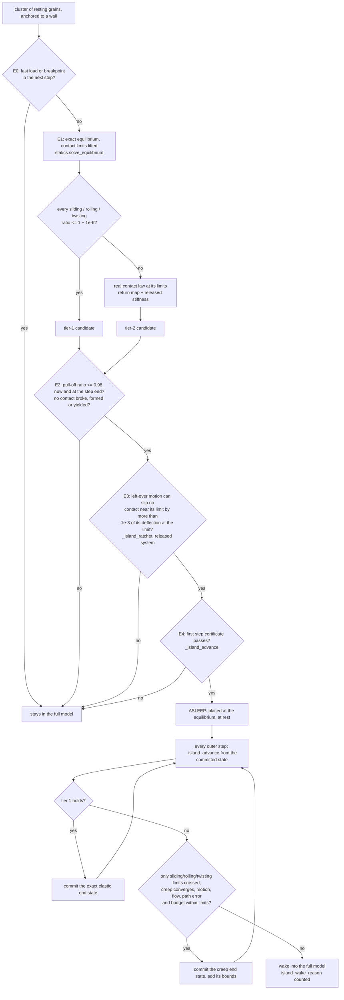

# Resting clusters that sleep at their contact limits: design record

This folder is the complete record of one engine change, from the measurement that motivated it to the code and the
checks. Every stage is kept as it was written, so anyone can follow each decision, see what was rejected and why, and
check the final logic against the code.

Paths: since v0.7 (10 Nov 2026) the v0.6 engine is in `extras/` (`dolle_sim/engine.py` is now
`extras/dolle_extras/engine.py`, `tests/test_full_engine.py` is `extras/tests/test_full_engine.py`, and so on).
This page uses the new paths; the stage records 01-06 are verbatim and keep the old ones.

**Status (10 Nov 2026): implemented and verified against the full model.** The code is in `extras/dolle_extras/engine.py`,
`extras/dolle_extras/statics.py` and `extras/dolle_extras/loads.py`. The 13 existing engine checks, the unit tests of the helper
functions and the six checks that compare the new treatment with the full model (14-19, section 5) pass. Writing
those six checks found three faults, fixed in the code (section 5). A review of the implementation then found eleven
more, all fixed (section 6).

## 1. The problem, as measured

The v0.6 engine lets a resting cluster of grains "sleep" (stop being integrated) only when every contact is far from
its limits: at the cluster's exact equilibrium, every load ratio (normal pull-off, sliding, rolling and twisting load,
each divided by its limit) had to stay at or below 0.90 to enter and 0.98 to stay. That test is a linear-response
prediction, and a linear prediction cannot tell whether a contact sitting exactly at its limit will slide or roll a
little further. So the test kept such contacts out.

On 29 Oct 2026 the campaign's own saved states (nominal scenario, 100 grains per tubule) were loaded and every
cluster the engine refused to put to sleep was examined (the numbers are in [01_brief.md](01_brief.md)):

* nearly all computing went to clusters that were **static** (speeds 1e-13 to 2e-9 m/s), integrated by the full
  contact model at 5-18 ns steps (4e7-1.2e8 steps per flight-second);
* in the boost and coast (8 g along the walls from the spin), their worst contact sat **at its rolling limit** (ratio
  >= 0.999), so the 0.90 entry test could never pass;
* in microgravity, an edge grain refused at a twisting ratio of 0.962 and a 3-grain bridge at a rolling ratio of
  0.926; these would have stayed in the full model for the remaining 800 s of flight;
* cost: 1e3-1e4 s of computing per flight-second in the coasts, days per tubule in microgravity, weeks for the
  campaign.

A contact at its limit is not moving. It changes only if the load pushes it further along its limit (plastic flow) or
if left-over vibration ratchets it. The task was to let such clusters sleep while keeping every result **exact** (the
full model would change nothing) **or bounded** (any change it would make is computed, reported and kept below a
published limit).

## 2. How the design was made

| step | file | what happened |
|---|---|---|
| 1 | [01_brief.md](01_brief.md) | One brief for everyone: the code, the measurements, the standard (exact or bounded, verified against the full model). |
| 2 | [02_design_A_unloading_certificate.md](02_design_A_unloading_certificate.md) | Independent design A: prove the load cannot rise past the limit over the step (smallest change). |
| 3 | [03_design_B_nonlinear_verification.md](03_design_B_nonlinear_verification.md) | Independent design B: do not trust the linear prediction near a limit; evaluate the real contact law at the predicted state (Newton certificate). |
| 4 | [04_design_C_risk_first.md](04_design_C_risk_first.md) | Independent design C: list every way sleeping at a limit could silently differ from the full model, then design against each. |
| 5 | [05_synthesis.md](05_synthesis.md) | Read the code, judged each design's claims against it, took the best of each (section 8 lists what was wrong in each design). |
| 6 | [06_critique.md](06_critique.md) | Adversarial review of the synthesis: findings A1-E5. Two would have let the stated bound be exceeded (A1, A2), one would have made the measured clusters never sleep (C1). Its "corrected criteria" are what was implemented. |

None of the three designers saw the others' work. The synthesis and the critique were each done by a fresh reader with
only the code and the previous stage.

## 3. The logic, as implemented

Two treatments, decided freshly every step from the same calculation:

* **Tier 1, static (exact).** Lift the contact limits (make them infinite), find the exact elastic equilibrium at the
  end of the step and halfway, and bound how far every contact load can stray between those samples. If even the
  worst case stays within every sliding, rolling and twisting limit (to 1 part in 1e6), the real contact law never
  reaches a limit during the step, so it changes no plastic variable. The cluster's new state is then exactly the full
  model's quasi-static state.
* **Tier 2, creep (bounded).** If the elastic prediction does cross a limit, the cluster is advanced with the real
  contact law's own rule for flow at the limit (the kernel's "return map"), solved to equilibrium. The step is done
  twice (one step, then two half steps) and the difference measures the error. Every error term is added up per
  cluster, and the cluster is woken when the total reaches 1% of the deflection at the limit (`island_budget_rel`).
  The terms that tier 1 certifies are budgeted here through the released structure (springs at their limits
  removed): a load excursion beyond the chord, including the limit's own change with the normal force; the Newton
  residuals (summed); and the lag the creep's own dynamics leave behind the quasi-static creep (its running maximum,
  not a sum: see section 3, deviation 5).

Anything else wakes the cluster into the full model, and the reason is counted (`island_wake_<reason>` in the run's
`n_events`).



### Entry: `FullContactSim._try_sleep_island` (engine.py)

| test | what it checks | why |
|---|---|---|
| E0 | No fast load (release waveform, vibration) or load breakpoint in the next step; the contact system is the touching contacts plus every member pair or member-wall pair closer than `island_gap_m` (2 x the capture distance) as inactive contacts (`_island_near`); the elastic stiffness factorises. | Fast loads are resolved only by the full model. The inactive pairs let a solve notice a contact about to form (critique B1). |
| E1 | Exact equilibrium of the current load from the full model's state (Newton with the limits lifted; per-degree-of-freedom tolerances, `_island_tols`). Tier 1 if all sliding/rolling/twisting ratios are <= 1 + `island_tol_rel` there, else the real contact law's return map with the consistent tangent (`_island_tangent`, `statics.released_stiffness`) places it as tier 2. A mechanism or no convergence refuses. | The placed state must be an exact equilibrium of the real contact law (critique C1: the plain elastic iteration stalls exactly for the piles at their limits). |
| E2 | Pull-off ratio <= 1 - `sleep_margin` now and at the step end (load taken just before any breakpoint), including the left-over motion's largest effect; nothing broke, formed or yielded in the solve. | A normal contact near pull-off is a genuine instability. |
| E3 | Left-over energy E_res = the kinetic energy of the motion relative to the drift of the equilibrium under the step's load change (`_island_drift`; the kinetic energy itself under a constant load) + the elastic deviation from the equilibrium. For every contact component near its limit, its slip bound in the **released** system (springs at their limits removed, `_island_ratchet`, iterated until every component the bound brings near its limit is released too) must stay below `island_ratchet_rel` (1e-3) of its deflection at the limit; every contact with no component near its limit must keep the previous 1%-of-remaining-margin test, since the residual is then dropped. | Critique A1: at a limit the external load, not the left-over energy, does the plastic work, so the slip equals the left-over motion's amplitude in the structure without that spring. The earlier bound E/cap was low by 1e2-1e5. |
| E4 | The first step's certificate (`_island_advance`) passes on the candidate; for tier 1 the ratios extrapolated over 20 steps stay inside the limits, otherwise the cluster enters as tier 2; no other sleeper is within that step's reach (`_sleepers_near`, refused as `cluster_awake_neighbour`). | Do not place a cluster that would wake at once; only an accepted candidate is written into the simulation state (critique D1). |

### Every step: `FullContactSim._island_advance` (engine.py)

The deviation bound for each contact component k is

`D_k = rn_k (||dF_chord|| + 2 (||r_1|| + ||r_0|| + ||r_mid||) + ||f_dyn||) + 2 |lam_mid - (lam_0 + lam_1)/2|_k`

where `rn_k` is the row norm of J K^-1 (`_island_row_norms`, translational and rotational parts separately);
`dF_chord` is how far the loads can stray from a straight line between the step's ends (`Loads.chord_dev`,
`Loads.spin_chord`, critique A4); `r_1`, `r_0`, `r_mid` are the Newton residuals at the end, start (including the
change of the long-range forces since the last commit, critique A7) and mid-step, counted twice because the doubled
mid-step term is measured from three states each exact only to its own residual; `f_dyn` covers the forces the slow
drift's own dynamics would need (`_island_fdyn`: inertia, Coriolis, drag, and the dashpots through the island's
damping matrix); and the last term is the path's measured deviation from the straight line, taken at mid-step and
doubled (critique A3). The `rn` terms are doubled while the stored tangent is not refreshed.

Loads at the end of a step are taken just before any breakpoint (`Loads.accel(T, side="-")`, critique A2). So a
cluster certified up to a load jump is committed at the pre-jump equilibrium, and the full model resolves the jump.
Single sleepers and tier-0 islands (which are not re-placed every step) are placed at the pre-jump equilibrium when
they are woken at the jump (`_jump_side`), for the same reason.

The drift allowance `s_isl` (the most a member may move inside the step, which every other grain's motion bounds
use) is the end displacement plus twice the measured mid-step deviation from the straight line, plus the largest
row of K^-1 (`_island_disp_norm`: the whole chain of deflections down a stack) times `dF_chord`. Two sleepers of
different groups (islands, single grains) are compared with each other at every step and every skip sample
(`_sleeper_contacts`): both wake (`island_wake_neighbour`) when their gap could close within the step.

Wake reasons (counted as `island_wake_<reason>`): `fast`, `loading` (a limit crossed with creep off), `pulloff`,
`break`, `yield`, `newcontact`, `mechanism`, `newton`, `motion` (creep moved more than `island_motion_m` = 1e-9 m in a
step), `flow` (more than `island_flow_max` = 5% of the deflection at the limit in a step), `twist` (a twist the
contact law would resolve from the sign of a round-off rate, critique B3), `path` (the two half steps differ from the
whole step by more than `island_path_tol` = 1e-3 of the deflection at the limit), `budget`, `approach` (a grain in the
full model came within twice the capture distance of a sleeping member), `neighbour` (another sleeper could touch
it within the step).

Bounds kept per cluster and reported in `n_events`: `island_bound_xi` (largest accumulated bound relative to the
deflection at the limit; the budget caps it at 1e-2), `island_flow_m`, `island_snap_rel`, `island_wake_transient_m`,
and the largest per-step Newton and dynamics terms relative to the limit, `island_newton_rel` and `island_dyn_rel`.

## 4. Each critique finding and where the code handles it

| finding | what could go wrong | handled by |
|---|---|---|
| A1 | ratchet bound low by 1e2-1e5 | `_island_ratchet` (released system via `statics.released_stiffness`), entry E3 |
| A2 | at a breakpoint the committed state was the post-jump equilibrium, dropping the jump's transient | `Loads.accel(..., side="-")`, `Loads.omega_dot(..., side="-")`; every step-end load in `_island_advance` |
| A3 | stale tangent dominated the nonlinearity term | mid-step solve, term `2 |lam_mid - (lam_0 + lam_1)/2|` in `_island_advance` |
| A4 | kink term off by 2 | `Loads.chord_dev` (`|Delta slope| l / 4`) |
| A5 | force and torque tolerances mixed | `_island_tols` (per degree of freedom) |
| A6 | no cumulative limit on tolerated error | `bnd["total_rel"]` and wake `budget` (`island_budget_rel`) |
| A7 | long-range force change between steps ignored | `r_0 = r_ref + Delta F_lr` in `_island_advance` |
| B1 | contact forming inside a drifting cluster undetected | `_island_near` (inactive pairs), wake `newcontact` |
| B2 | drifting clusters assumed static by the other grains' motion bounds | `s_isl` in `_watch` (join and step limit), `_capture_times`, `_early_exit`, `_slv_obstacles` (`_drift`) |
| B3 | twist resolved from the sign of round-off | `statics.twist_ambiguous`, wake `twist`; option `twist_continuity` (off, ASSUMED if switched on) |
| B4 | yield test woke contacts already flattened | yield read from the contact law's own transitions in `statics.solve_equilibrium` |
| C1 | plain iteration stalls for piles at their limits | `_island_tangent` (released-stiffness Newton) |
| C2 | motion limit too tight for early creep | `island_motion_m` = 1e-9 m (with `s_isl` everywhere) |
| C3 | tier-1 candidates about to flow refused instead of creeping | E4 falls through to tier 2 |
| C5 | ratchet test applied to components far from their limits | `near` mask in `_island_ratchet` |
| D1 | a refused cluster's state altered | entry and step work on candidate arrays; written only on acceptance |
| D2 | entry certificate counted as a sleeping step | `count=False` at entry |
| D5 | a broken contact's history committed by the fallback placement | `_wake_island` hands the committed state over instead |
| D6 | pull-off chatter at entry | 20-step extrapolation includes the pull-off ratio (clusters and single grains) |
| D8 | islands saved by the previous code version | `_island_upgrade` (placed at the exact equilibrium of the load at its first step, ratchet bound recomputed) |
| C4, D3, D4, E1-E5 | measurements, wording, test budget, the checks themselves | checks 14-19 written and passing (section 5); open: diagnostics on the campaign's states (C4) |

### Where the implementation differs from the critique (each is stated in the code's docstrings)

1. Row norms are taken separately over translational and rotational degrees of freedom (`_island_row_norms`). One
   combined norm mixed torque sensitivities with force residuals and overstated a 1e-16 N residual as 4e-4 of a
   rolling limit, which would have pushed every cluster at its limit into creep.
2. The left-over energy of a changing load. The first implementation charged the whole kinetic energy plus the
   step's load-change energy |dF| |K^-1 dF| times `min(1, 4/(omega_min H)^2)`, the implementer's own derivation (no
   outside source). Check 14 showed that this refuses a cluster that the full model carries along a slowly turning
   load at its limits at every step (58 of 58 entry attempts refused as `cluster_awake_ratchet` for the 30-degree
   turn): such a cluster moves with the drift of its equilibrium, not about it. It now charges the kinetic energy of
   the motion relative to that drift (`_island_drift`: (|v - u0|_M + |u_h - u_f|_M)^2 / 2, u_f and u_h the drift
   rates over the step and its first half, u0 = 2 u_h - u_f, the larger of the elastic and the released system).
   **This is also this project's own derivation, with no outside source** (exact for an undamped linear system whose
   equilibrium starts to drift at a constant rate). Check 18 measured the slip a load ramp leaves at a capped spring in
   the full model (6.2e-15 m for a ramp over one step, 1.7e-15 m for a continued ramp) against the bounds of both
   versions (old factor 1.0e-11 and 2.1e-12 m, present 5.7e-14 and 1.1e-14 m): both hold, and the lowest frequency of
   the released stiffness gave the same factor as the elastic one (1.69e-3) for that grain, so the question whether
   the old factor needed the released stiffness did not arise in practice.
3. The previous 1%-of-remaining-margin test for left-over motion is kept for contacts that are not near a limit. When
   no component of the cluster is near a limit and the test fails, the motion is tracked as exact linear response
   (`_linres`, as before); when one is, the motion is dropped at entry (its slip at the components near their limits
   is bounded by E3), so every contact with no component near its limit must pass the 1% test, else the cluster stays
   in the full model (`cluster_awake_ratchet`). The first implementation did not apply the test in that case (found by
   the review, section 6).
4. At entry, "near a limit" means within the sleep margin (2%), because the step's deviation bound is not known yet.
5. Tier 2 charges the dynamics term as a lag, not a sum (`dyn_m`, its running maximum in `total_rel`). While a spring
   creeps, its slip is its relative displacement less its fixed deflection at the limit, so the full model's lag
   behind the quasi-static creep (at most rn_rel ||f_dyn|| / k at that spring) is the whole of its slip error, and it
   keeps at most that value when it stops. **This is this project's own argument, with no outside source**, from the
   linearised dynamics of the released structure with the set of springs at their limits fixed; beyond that it is
   ASSUMED. Summing the lag at every step instead woke the 30-degree turning case of check 14 by its budget after one
   or two steps (asleep 25% of the island-steps, with the dynamics term at 6e-3 of the limit per step, when the
   dashpots were still bounded by the largest coefficient of any kind; through the damping matrix it is 4e-5).

## 5. What is verified now, and what is not yet

| verified | how |
|---|---|
| The helper functions (`statics.lift_caps` ... `statics.twist_ambiguous`): the lifted law is bit-identical to the real one below the limits; the real law's return map at a limit; the released stiffness; the equilibrium solver converges, detects mechanisms and contact breaks | `extras/tests/test_statics_caps.py` (10 tests) |
| Left limits at breakpoints; the chord-deviation bound holds on 50 random steps over the whole flight profile, including steps containing a kink; it is exact on the parachute and splash pulses | `extras/tests/test_loads_chord.py` (6 tests) |
| All 13 existing engine checks still pass on the new engine (contact law vs 1-D model, conservation, rolling, cluster statics, vibration, time step, slaved rolling, exact sleep, hand-off, regimes, linear-response sleep, slaved clusters) | `python -m pytest extras/tests/test_full_engine.py -k full_engine_check` |
| 14 `cap_sleep_vs_dem`: a grain in an edge and a 3-grain corner cluster, floor rolling springs at their limits (ratios >= 0.9996), 30 ms of the engine vs the full model at 50 and 100 steps per contact period under (a) constant loads, (b) pressing 2 -> 0.2 g, (c) the sideways load turning by 30 degrees | asleep 95-97% of the island-steps; same contacts; positions and springs within 3x the full model's step error + the reported bound (largest: (c) twist 1.6e-7 rad against 4.3e-7); (a) every state committed at an unchanged load bit-identical to the placed one |
| 15 `cap_twist_microgravity`: a grain in an edge with locked-in contact forces, both twisting springs at 0.96 of their limit, 1e-4 g turning at 1/60 Hz, 0.5 s | asleep from the first classification (499 of 500 steps, 0.499 s skipped); twist changes 1.5e-8 (engine) and 1.4e-8 (full model) of the limit angle; twist kept; positions 1.2e-14 m apart |
| 16 `creep_island_vs_dem`: a 2-grain stack and a 5-grain corner pile at their limits under the burn's growing load (its first 30 ms) and the coast's shrinking pressing load; a 2-grain stack on a floor with both rolling springs at their limits | creep in 100% of the sleeping steps; 9.2 and 8.9 Newton iterations per creep step; springs and positions within 3x step error + the reported bound; island_bound_xi <= 1.2e-4; the true mechanism refused as `cluster_awake_mechanism` and never asleep while the full model rolls it 449 um in 10 ms |
| 17 `between_sample_bound`: a resting 3-grain row under the nominal flight profile (drag decay, splash, spin-up, a descent-table knot, the de-spin knot), 100-180 steps each, the exact equilibrium on 20 points inside every step | 0 violations in 11800 grid points; smallest slack 2.7e-11 |
| 18 `ratchet_released_bound`: a grain in an edge at its rolling limit with left-over motion of 1e-25 to 1e-18 J, and under two load ramps | slip 2.5e-14 to 8.0e-11 m, always within the released bound (9x margin); the superseded E/cap bound exceeded in 4 of 5 cases; the ramps within the bounds of item 2 |
| 19 `island_across_breakpoint`: a 3-grain cluster at its rolling limits across the de-spin knot | committed at the pre-jump equilibrium (1.8e-16 m from it, 6.2e-10 m from the post-jump one); engine vs full model within 3x step error; the jump's permanent slip 2.6e-11 m within the released bound of its energy dF^T K_rel^-1 dF / 2 = 5.4e-19 J (6.4e-10 m) |

The measured values above are from one run (10 Nov 2026; checks 14 and 16 rerun after the review's fixes); [CHECKS.md](../../../../CHECKS.md) has those of the latest
full run. Faults found by writing checks 14-19, all fixed:

1. `statics.solve_equilibrium` applied the lifted contact law at zero displacement, which in floating point is not
   the identity (the projection of a spring onto the tangent plane is not idempotent): a cluster asleep under a
   constant load had its springs changed by round-off at every step (check 14 a). The reference state is now
   returned as it is there.
2. `_skip_asleep` could start a skip at a load breakpoint and carry the committed pre-jump states across the jump
   (check 19); it now skips nothing from a breakpoint, and the step there wakes the sleepers.
3. The entry energy of a changing load (item 2 of the list above; check 14 c).
4. Found at the same time by a unit test (`test_skip_asleep_advances_islands_in_lockstep`): when one island failed a
   sample of `_skip_asleep`, the others had already counted that sample as a step slept, although the stepping
   redoes it (critique D2). Their step counters are now restored for the failed sample.

Not covered by these checks: the campaign's own states (finding C4, the speed-up), clusters of more than 5 grains, and
the residual motion the engine drops at entry for contacts far from their limits (bounded by the previous version's
1%-of-margin test, `test_entry_dropping_a_residual_keeps_the_one_percent_test_for_contacts_far_from_their_caps`;
check 19 places its prepared state at rest, because the engine would refuse the residual its settling leaves).

Measurements the implementers made against the full model while coding (scratch scripts, not part of the suite):
a pair of grains held at its rolling limits slept under constant load with positions equal to the full model's to
1.5e-17 m; under a growing sideways load it crept (17 creep steps) and its rolling springs matched the full model's to
6e-14 m, within the full model's own step error of 6.3e-14 m; a flying grain hitting a sleeping 3-grain row woke it
with no missed contact, and the final positions matched the full model to 2.8e-11 m (step error 7e-9 m).

## 6. Review of the implementation (10 Nov 2026)

A review of the code (one reviewer per finding, each confirmed by a second who tried to refute it with a run) found
eleven faults. All are fixed in `extras/dolle_extras/engine.py`; each but one has a unit test in `extras/tests/test_full_engine.py`.

| finding | what went wrong | fix | test |
|---|---|---|---|
| sleeper next to sleeper | a drifting island could close a gap to a separate sleeping island or grain unseen (nothing compared two sleepers; the review's run: a 1.5e-13 m gap closed in 5 steps, no contact formed) | `_sleeper_contacts` every step and skip sample (wake `neighbour`); `_sleepers_near` at entry | `test_sleeping_island_wakes_when_it_could_touch_another_sleeper` |
| wake at a jump | single sleepers and tier-0 islands woken at a breakpoint were placed at the post-jump equilibrium, dropping the jump's transient | `_jump_side` in `_wake` and `_wake_island` | `test_single_sleeper_and_tier0_island_woken_at_a_breakpoint_start_from_the_pre_jump_equilibrium` |
| ratchet, one pass | a component found near its limit only by the released bound was not released itself (bound low by 10x in a two-spring example) | `_island_ratchet` iterates to a fixed point | `test_entry_ratchet_releases_every_component_it_finds_near_its_cap` |
| tier-2 curvature | the excursion beyond the chord was charged through the elastic row norms of the spring's own kind; the limit's change with the normal force was missing (6.9x the charge on check 16's pile) | released row norms + mu x normal row norm, at components that can reach their limit | `test_creep_step_charges_an_excursion_beyond_the_chord_through_the_released_structure_and_the_caps` |
| tier-2 residuals | Newton residuals and drift dynamics were recorded, not budgeted or reported | `resid_m` (summed) and `dyn_m` (lag) in `total_rel`; `island_newton_rel`, `island_dyn_rel`; dashpots through the damping matrix | `test_creep_island_follows_its_shrinking_cap_and_reports_its_bounds` |
| dropped residual | with a component near its limit the 1% test was skipped for the far contacts | deviation 3 above | `test_entry_dropping_a_residual_keeps_the_one_percent_test_for_contacts_far_from_their_caps` |
| upgrade | an island of the previous version kept its old reference load, so a wake in its first step handed over the equilibrium of a load left long ago (1.7e-12 m off after a 1 g change) | `_island_upgrade` places it at the exact equilibrium of the load at its first step | `test_island_of_the_previous_format_is_upgraded_at_the_load_of_its_first_step` |
| drift allowance | `s_isl` missed out-and-back loads and the chain of deflections down a stack (2-5x) | section 3 above | `test_drift_allowance_covers_an_out_and_back_load_through_a_stack` |
| mid-step residual | the mid-step solve's own residual was not in D | D above | (covered by `check:between_sample_bound`) |
| skip counters | a skip sample that failed kept its Newton iterations and refactorisations counted | `_skip_asleep` restores all of `n_events` | `test_skip_asleep_advances_islands_in_lockstep` |
| mid-step wake | the placement was tested against the previous step's allowance | `_wake_island` uses this step's | `test_mid_step_wake_tests_its_placement_against_this_steps_allowance` |

## 7. How to check it yourself

```bash
python -m pytest extras/tests/test_statics_caps.py extras/tests/test_loads_chord.py -q
python -m pytest extras/tests/test_full_engine.py -q
python -m dolle_extras verify --json results/verify_extras.json
```

Every result file the checks write is turned into [CHECKS.md](../../../../CHECKS.md) by `tools/checks_table.py`.
